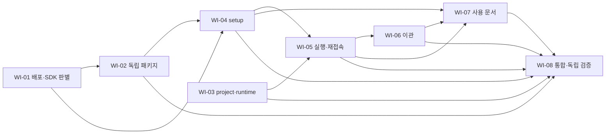

# Workbench 독립 설치와 프로젝트별 운영 — 구현 명세 초안

Revision: s1. Source: [BRIEF.md r0.4](BRIEF.md), SHA-256 `21bd3ccc3edb3814084391d6b9801e31dd11188a6b819d36e00c7bd4fc5a892f`.
상태: combined bundle 승인 대기. WI-D01~10의 사용자 결정은 유지한다. BRIEF의 WI-P01/P03~07, 아래 기술 상세·공개 seam은 이번 계획의 제안이며 사용자 승인으로 표시하지 않는다. 실제 승인과 digest는 [approval.json](approval.json), 운영 기록은 [state](../../../.workflow/workbench-installation/state.json)에서 별도로 관리한다.

## 문제와 해법

연구 프로젝트에 WB 개발 checkout·Python 의존성·내장 skills를 설치해야 하는 사용 흐름을 없애고, 프로그램 설치본과 프로젝트별 이력을 분리한다. Git 버전을 uv tool 환경에 설치하고 `wb setup`으로 OMP를 준비한 뒤 연구 폴더에서 `wb`를 실행한다. 프로그램·내장 자산은 설치본, 이력·DB·로그·OMP 대화는 프로젝트 `.wb/`, 재생성 runtime은 프로젝트 밖에 둔다. 기존 상태는 명시적인 중단 상태 이관으로 원본을 보존한다.

## 사용자 시나리오

- WB를 설치한 연구자가 프로젝트 A에서 실행하고 하위 폴더에서 다시 접속해 같은 이력을 본다. 프로젝트 B에서는 별도 이력을 사용한다.
- OMP가 있는 사용자는 기존 설치를 그대로 사용한다. 없는 사용자는 WB의 setup으로 필요한 프로그램·runtime을 준비하고 OMP 로그인 안내를 따른다.
- 기존 explicit data-dir을 쓰던 사용자는 기존 명령으로 계속 접근하거나, 원본을 보존하며 지정한 프로젝트 `.wb/`로 이관한다.
- 문제가 생기면 Manager에서 기존 user-only report skill을 호출한다. 설치본의 reference/helper를 사용하므로 프로젝트에 skills를 복사하지 않는다.

## 범위와 비목표

포함: Git tag/commit의 noneditable uv tool 설치, 배포 자산 closure, `wb` 진입점과 `setup`, 프로젝트 식별·Git 제외·runtime 분리, 기존 CLI/명시 data-dir 호환, 원본 보존 이관, 사용 문서, 실제 설치본 통합 검증.

제외: PyPI 준비·게시, Windows, 내부 tmux/herdr, 프로젝트 환경 관리자 대행, systemd 자동 등록, uvx 장기 backend 보장, 원격 공유 상태, live 이관·이력 병합/분할, nested-project 초기화 전용 명령, 폴더 복제/이동 뒤 자동 복구, 새 doctor/update/uninstall 명령. 프로젝트 상태 삭제나 원본 정리를 자동화하지 않는다. 이 제외 범위 중 BRIEF에서 제안으로 남은 부분도 함께 승인받을 대상이다.

Core의 승인·입력 owner·pause·no replay·프로세스 수명, [ADR-0001](../../adr/0001-no-external-multiplexer.md), [ADR-0002](../../adr/0002-managed-shell-control-wait.md)를 유지한다. 로그 정책·Q-01·rotation 별도 활성화 계약은 [로그 BRIEF](../dev-validation-log-retention/BRIEF.md)를 따른다. 새 위치로 옮겼다는 이유로 삭제를 활성화하거나 이전 검증 결과를 새 경로의 통과로 만들지 않는다.

## 공개 인터페이스와 불변 조건

### 설치와 실행

다음은 구현 후 제공할 흐름이다. `<implemented-ref>`는 이 구현을 포함하는 실제 tag/commit으로 치환해야 하며 현재 HEAD의 설치 성공을 주장하지 않는다.

```sh
uv tool install 'git+https://github.com/dwchoo/ai-exp-assistant.git@<implemented-ref>'
wb setup
cd /path/to/research
wb
```

uv, Git 접근 인증, Python >=3.12는 사전 요건이다. OMP와 그 설치 방식에 필요한 runtime의 준비는 setup의 책임이다. 연구 프로젝트의 venv/conda에 WB를 설치하거나 WB tool 환경을 연구 환경으로 주입하지 않는다.

`wb` 무인자는 start 동작으로 진입한다. `wb start`, `attach`, `status`, `shutdown`, `setup`, `migrate`를 제공한다. 기존 `omp-workbench` entry point 및 `confirm-boot`, Task/log/summary 관련 세부 명령과 옵션을 유지한다. 기존 parser의 명령별 옵션 위치를 호환하며 옵션 재배치를 새 필수 요건으로 만들지 않는다. `--help`는 시작·초기화하지 않는다.

- `wb setup [--omp PATH]`: 사용자 전역 프로그램 준비이며 cwd의 `.wb/`를 만들지 않는다. 기존 `WORKBENCH_OMP` 선택도 유지한다.
- `wb [start]`: 기존 backend가 있으면 검증 후 연결하고 없으면 준비 요건과 프로젝트 확인을 거쳐 시작한다. `start --no-attach` 등 기존 옵션도 유지한다.
- `wb attach/status/shutdown`: 기존 context를 조회하며 프로젝트를 새로 만들지 않는다. shutdown의 기존 확인·정리 계약을 유지한다.
- `wb migrate --from PATH --project PATH`: 단일 기존 data-dir을 명시한 프로젝트 `.wb/`로 이관한다. 성공해도 backend·실험을 자동 시작하지 않는다.
- `--data-dir` > `WORKBENCH_DATA_DIR` > 프로젝트 탐색. 명시 data-dir은 legacy 상태를 계속 사용할 수 있다. 예전 사용자 전역 기본 경로는 자동 탐색·이관하지 않고 명시 경로 또는 migrate로 접근한다.

### 프로젝트와 경로

계획의 공유 계약은 `ProjectContext`(canonical project root, durable data root, runtime root, 선택 출처, identity, 초기화 필요 여부)와 분리된 durable/runtime layout이다. 정확한 Python 서명은 WI-03이 기존 호출자와 호환되게 정하지만 필드 의미·동작은 이 문서를 따른다.

| 자료 | 제안 위치와 규칙 |
|---|---|
| WB Python·TS bridge·skills/reference/helper·agents·기본 overlay/models·policy | uv tool 설치 package resources. 연구 프로젝트로 복사하지 않는다. |
| Task DB, raw/important logs, workflow 기록, OMP session, backend 진단 이력 | `<project>/.wb/`. 기존 보존 정책을 그대로 적용한다. |
| 프로젝트 marker | `.wb/project.json`: schema version 1, 임의 project UUID, canonical root, initialized/completed 상태. credentials·실행 승인은 넣지 않는다. |
| OMP 가변 home | durable root의 기존 `omp-root/agent` 계열. role-specific 가변 자료·대화는 프로젝트별, skill 원본은 설치본이다. |
| 인증 | 기존 OMP 사용자 저장소를 링크한다. auth DB나 credential 내용은 프로젝트·이관 bundle로 복사하지 않는다. |
| setup 선택 | absolute `XDG_CONFIG_HOME` 또는 `~/.config` 아래 `omp-workbench/setup.json`. 경로·실제 버전·출처/recipe·준비 결과만 저장한다. |
| WB가 관리하는 OMP/runtime 프로그램 | absolute `XDG_DATA_HOME` 또는 `~/.local/share`의 `omp-workbench/tools/` 아래 versioned 사용자 전용 prefix. 프로젝트 간 공유한다. |
| socket·재생성 cache | 유효한 private `XDG_RUNTIME_DIR`/cache 경로의 프로젝트별 namespace. UDS에 너무 길거나 runtime 경로가 없으면 `/tmp/omp-workbench-<uid>/` 아래 검증한 0700 짧은 경로를 사용한다. |

runtime namespace는 canonical data root와 project identity에 묶고 길이를 고정한다. 모든 UI/bridge socket의 filesystem byte 길이를 107 이하로 확인한다. 충돌·symlink·다른 사용자 소유 경로는 거절한다. runtime 위치가 달라져도 durable identity record의 기존 endpoint/lock/process를 먼저 대조해 duplicate backend를 만들지 않는다. legacy `DataLayout(root)`의 기존 저장소 접근을 보존하면서 optional runtime layout을 추가한다. 실행 중 legacy socket/lock을 몰래 이동하지 않는다.

현재 cwd에서 위로 탐색하여 **처음 만나는 `.wb`**를 검사한다. 유효하면 그 root를 사용하고 잘못된 파일·marker·권한·불완전 이관이면 거기서 멈춘다. 잘못된 항목을 건너뛰어 다른 프로젝트에 연결하지 않는다. Git root를 강제하지 않으며 Git 없는 폴더도 지원한다. cwd는 canonical 경로로 정규화하되 `.wb` 자체의 symlink는 허용하지 않는다.

새 프로젝트에서는 첫 실행 폴더를 보여주고 기본 거절인 확인을 받는다. non-TTY 입력이나 거절에는 생성·시작하지 않는다. OMP 등 시작 요건도 확인한 뒤 marker를 원자적으로 게시한다. setup 미완료인 거절된 start가 `.wb/`를 남기지 않도록 기존 refused-start 경계를 유지한다. 하위 폴더에서 backend를 새로 시작해도 host shell의 project root는 확인된 root이며 subdir cwd로 덮어쓰지 않는다.

Git 프로젝트에서는 project root의 `.gitignore`에 `/.wb/` 규칙을 추가한다. 기존 bytes/규칙을 보존하고 변경이 필요한 경우만 추가한다. 일반 Git과 linked worktree를 구분해 Git 명령으로 추적 상태를 확인한다. 이미 추적된 자료나 ignore 적용 실패는 경로와 원인을 표시하고 untrack·삭제하지 않는다. **제안된 실패 정책:** Git 제외를 달성하지 못한 신규 초기화는 완료·backend 시작을 보류한다. 비Git에는 불필요한 `.gitignore`를 만들지 않는다. 기존 상태의 조회·진단을 삭제나 자동 수정과 결합하지 않는다.

명시 data-dir에는 marker를 강제하여 legacy 접근을 깨지 않는다. 기존 backend가 있으면 기록된 project root와 실제 process identity를 대조해 사용하고 effective project/data/runtime 위치를 표시한다. 명시 선택 자체를 cwd 불일치 오류로 취급하지 않지만 다른 프로젝트의 backend에 묵시적으로 연결해서는 안 된다.

### setup과 OMP

선택 순서는 명시 `--omp`/기존 `WORKBENCH_OMP`, 이전 setup 선택, PATH다. 발견한 후보가 실행 불가·고장·확인된 비호환이면 그 원인을 반환한다. 후보가 **없을 때** 새 설치한다. version 문자열이 기존 검증 이력과 다르다는 이유만으로 재사용을 막거나 검증 버전으로 교체하지 않는다.

설치 transaction 시작 시 최신 stable을 resolve하고 그 transaction의 실제 버전·다운로드 출처·integrity를 고정한다. 설치 도중 latest를 다시 선택하여 CLI와 SDK가 달라지지 않게 한다. 사용자 prefix에 staging 후 다운로드·무결성·실행·필수 SDK 로드 확인이 성공해야 active 선택을 게시한다. setup lock으로 동시 교체를 막고 실패 시 기존 선택을 보존한다. 필요 runtime도 사용자 전용 prefix에 준비한다. sudo, 기존 설치 덮어쓰기, shell rc 변경, 임의 PATH 영구 변경은 하지 않는다.

준비 결과는 실제 path/version, reused/installed/failed, 로그인 안내, 실행 가능 확인과 미검증 경계를 표시한다. 로그인은 기존 OMP의 사용자 흐름을 안내한다. setup 성공을 로그인 완료·모든 모델 호환 검증으로 표시하지 않는다. setup은 외부 모델 turn이나 연구 실험을 시작하지 않는다. 시작 요건이 부족한 일반 `wb`는 setup 안내로 멈추며 다운로드하지 않는다.

새 OMP 배포 recipe는 WI-01의 **판별 대상**이다. 공식 binary가 현재 bridge의 embedded SDK imports까지 충족하면 binary를 사용한다. 부족하면 공식 Bun package를 private prefix에 설치하는 bounded 후보를 판별한다. 필요한 SDK/runtime·무결성 확보 없이 `--version`만으로 성공 처리하지 않는다. 두 후보가 모두 실패·불명이라면 해당 소비 ticket을 보류하고 새 근거로 해결한다. SDK private API나 오래된 version pin으로 요구를 바꾸지 않는다.

설치본 업데이트는 backend 전체 종료 후 명시적으로 수행하도록 안내한다. Git ref 고정 설치는 새 ref로 명시 재설치하는 절차를 설명한다. OMP 업데이트도 선택된 관리 방식의 명시 절차를 안내하되 기존 프로그램에 자동 적용하지 않는다. 실행 중 자동 업데이트와 downgrade DB 호환 보장은 없다.

### 이관 transaction

source/target 경로를 canonical하게 대조하고 서로 같거나 중첩되면 거절한다. source는 알려진 단일 legacy 저장소여야 한다. target project의 `.wb`는 존재하지 않아야 하며 빈 디렉터리도 임의로 인수하지 않는다. 이미 완료·미완료 상태가 있으면 그 경로와 진단을 반환한다. 병합·덮어쓰기·자동 재시도 삭제를 하지 않는다.

source/target backend 및 관련 writer가 중단되었음을 기존 lock, 기록, PID 시작시각/boot/process 증거로 대조한다. running 또는 unknown은 사용자 종료/확인 안내로 거절한다. 살아 있는 프로세스를 강제로 죽이지 않는다. migration과 신규 start/init은 공통 lock 경계를 사용하며, 기존 source lock을 안전하게 확인할 수 없으면 쓰기 없는 이관을 주장하지 않는다.

1. 원본의 파일 분류·bytes/hash/size·mtime·DB/WAL·session·경로 참조 inventory를 만든다. 예상 못한 schema/특수 파일·symlink는 명시적으로 분류하거나 거절하며 조용히 누락하지 않는다.
2. target와 같은 filesystem의 private staging에 복사한다. source의 DB/WAL을 먼저 안정된 복사본으로 만들고 SQLite recovery/backup·checkpoint는 **target staging**에서만 수행한다. source DB에 접속하여 journal/SHM을 생성하거나 checkpoint하지 않는다. 전후 source hash/mtime를 대조한다.
3. Task/spec/revision/run/command ID와 raw/important logs·OMP session의 지속성을 검증한다. 복사 bytes/hash 대조뿐 아니라 DB integrity/known rows와 공개 reader 재오픈을 확인한다. normalized target DB는 source DB 원본 bytes와 별개로 논리 내용·완료 상태를 대조한다.
4. data-dir을 나타내는 알려진 **운영 참조**만 새 root로 결합한다. 원문 로그·과거 명령·승인 기록의 문자열을 일괄 치환하지 않는다. legacy raw reader의 절대 경로 비교, workflow 기록의 경로, OMP home/auth link, backend/boot/summary identity를 각각 다룬다. 새 위치의 compatibility/preflight는 새 경계로 검사하며 이전 통과를 복제하지 않는다.
5. 외부 실험 결과·Git worktree는 원본 참조로 유지하고 접근 여부를 표시한다. source 내부 Git worktree도 복사만으로 새 Git 등록이 유효하다고 가정하지 않고 원본 보존 참조로 분류한다. 실행용 worktree를 새 활성 실행으로 재등록하지 않는다. 원본 의존 참조는 manifest와 완료 결과에 명시한다.
6. socket/PID/실행 승인·오래된 제어 요청을 새 live 상태로 사용하지 않는다. 과거 이력은 보존하되 active control record와 분리한다. 정상 start의 boot/recovery 확인 경계를 유지한다. 이관만으로 실험·명령을 replay하지 않는다.
7. 검증 manifest와 completed project marker를 fsync·원자 게시한 뒤 완료 위치를 안내한다. 원본은 삭제하지 않는다. 실패/중단 staging 또는 미완료 대상은 완료 project로 탐색하지 않으며 경로·실패 단계·다음 진단을 표시한다. 부분 대상을 임의로 지워 재시도하지 않는다.

이관은 원본의 모든 프로젝트를 자동 분할하거나 독립적인 휴대용 research bundle을 만드는 기능이 아니다. 외부/원본 참조가 필요할 수 있음을 사용자에게 알리고, 내부 영속 storage 참조의 검증 실패는 미확인 경고만으로 성공 처리하지 않는다.

## 상태 전이와 실패

| 경계 | 상태와 실패 동작 |
|---|---|
| 준비 | unprepared → checking → reused 또는 staging → ready. 실패하면 failed + 원인/재시도이며 이전 ready 선택은 유지한다. |
| 프로젝트 | absent → proposed → confirmed → initialized. 거절/요건 실패는 absent 유지. invalid/incomplete/mismatched는 조회·진단만 하고 자동 실행 보류. |
| 연결 | resolved → identity 검증 → running attach 또는 새 start. 수명/owner 불명은 duplicate start·attach·자동 신호 전송을 하지 않는다. |
| 이관 | preflight → copying → verifying → completed. 실패/중단은 원본 보존, target incomplete, 정상 연결 금지. |
| 재시작 | 기존 boot/recovery 확인과 pause/no replay를 유지한다. source history는 새 실행 승인이 아니다. |

원인·effective path·필요한 사용자 행동을 출력한다. 일반적인 모델 지연·네트워크/요금 오류를 OMP 비호환으로 확정하지 않는다. 지원하지 않는 OS/arch·출처/무결성 불명·권한 문제는 setup에서 실패로 분리한다.

## 구현 결정

아래는 planning의 기술 구체화 제안이다. 공개 동작·수락 기준을 승인 없이 바꾸는 위임은 아니다.

- 새 의존성 프레임워크보다 Python 표준 라이브러리와 현재 setuptools를 우선 사용한다. Linux 우선이며 Windows 호환층을 추가하지 않는다. 실제 지원 arch/libc는 WI-01 관측과 설치 recipe에 한정해 기록한다.
- `src/workbench/assets.py` 계열 resolver와 build 시 생성하는 package asset tree로 checkout 추정을 대체한다. canonical 소스는 기존 `omp_bridge/`와 Python policy JSON이다. source checkout·wheel·sdist에 같은 manifest/hash 분류를 적용한다. runtime에 프로젝트로 자산을 복사하지 않는다.
- 자산 closure에는 TS entry뿐 아니라 `g3/`, `contract/`, skills/reference/scripts, agents, models/isolation, Python policy JSON과 shell helper가 포함된다. `summary_sdk.ts`의 `../../src/...policy.json` 같은 상대 참조와 `summary_compat*`의 checkout fingerprint도 교정 대상이다. 자산 변경을 기존 compatibility 보호 비활성화로 우회하지 않는다.
- `install_recipe`는 stable의 exact CLI/SDK version, artifact/source/integrity, 지원 host target, 필요한 runtime, bounded 실행 확인을 기술한다. recipe는 WI-01 검증 후 소비하며 공개 기능 변경이 필요한 결과는 issue로 남긴다.
- 프로젝트 resolver는 부작용 없는 discovery와 확인 후 init을 구분한다. durable lock/identity와 외부 runtime endpoints를 대조해 여러 시작 경로가 단일 backend로 수렴하게 한다.
- migration은 source bytes 보존, target staging 검증, source→target 운영 경로 mapping을 독립 구성한다. raw reader·workflow record·session을 실제 읽어 확인하며 raw 문자열 치환으로 대체하지 않는다.
- 제품 자산 내부 구현은 영어 skill/MCP 규약을 유지한다. 이 SPEC·tickets·README는 한국어다. 새 ADR로 미확정 기술을 확정하지 않는다.

## 수락 기준

번호와 의미는 BRIEF의 15개 WI-AC를 유지한다. 01~09는 개별 합의 기반이고 10~15 및 구체화 제안은 bundle 확인 대기다. 아래 local gate가 나중 ticket의 동작을 소급 요구하지 않도록 runtime 최종 확인을 G-WI-10으로 분리한다. PLAN이 gate supplier/owner의 유일한 원본이다.

| ID | 관측할 결과 | 구현 소유 / local gate | 최종 확인 |
|---|---|---|---|
| WI-AC-01 | Git tag/commit의 noneditable tool 설치, 개발 checkout·연구 의존성 불필요 | WI-02 / G-WI-02 | WI-08 G-WI-10 |
| WI-AC-02 | 설치본 skills/reference/helper 사용·기존 역할 격리·Manager user-only report 유지 | WI-02, WI-05 / G-WI-02,06 | WI-08 G-WI-10 |
| WI-AC-03 | A/B의 `.wb` DB·로그·이력 분리와 Git 제외 | WI-03, WI-05 / G-WI-03,06 | WI-08 G-WI-10 |
| WI-AC-04 | setup이 OMP를 점검·미설치 시 준비, 별도 수동 설치 불필요 | WI-01, WI-04 / G-WI-01,04,05 | WI-08 G-WI-10 |
| WI-AC-05 | 첫 실행 root 표시·확인 후 init, 거절은 미생성, nonGit 지원 | WI-03, WI-05 / G-WI-03,06 | WI-08 G-WI-10 (갱신: bare `wb` 밖 = Hub 목록, 초기화는 `wb init`/명시 `wb start`. [Hub SPEC](../workbench-hub/SPEC.md) 참고) |
| WI-AC-06 | 현재/상위의 가장 가까운 정상 `.wb`로 subdir 연결 | WI-03, WI-05 / G-WI-03,06 | WI-08 G-WI-10 |
| WI-AC-07 | 기존 실행 가능한 OMP 재사용, 없을 때만 공유 user prefix 설치·기존 보존 | WI-01, WI-04 / G-WI-01,04,05 | WI-08 G-WI-10 |
| WI-AC-08 | 설치 당시 stable, 명시 업데이트, 새 버전을 검증 통과로 위장하지 않음 | WI-01, WI-04 / G-WI-01,04,05 | WI-08 G-WI-10 |
| WI-AC-09 | legacy → `.wb` 복사·검증, 원본 보존, 자동 이관/원본 삭제 없음 | WI-06 / G-WI-07,08 | WI-08 G-WI-10 |
| WI-AC-10 | 영속 자료·설치본·외부 runtime 분리, 인증 미복사·긴 경로 지원 | WI-02,03,05,06 / G-WI-02,03,06,08 | WI-08 G-WI-10 |
| WI-AC-11 | invalid/충돌 `.wb`·Git 제외 실패를 표시, 덮어쓰기/untrack/다른 연결 없음 | WI-03, WI-05 / G-WI-03,06 | WI-08 G-WI-10 |
| WI-AC-12 | 중단·기록 없는 대상·비중첩, persistent reopen·완료 검증, 실패 불완료/no replay·외부 참조 보존 | WI-06 / G-WI-07,08 | WI-08 G-WI-10 |
| WI-AC-13 | wb 기본 start/attach, setup/start/attach/status/shutdown·기존 명령/flag/env 호환·사용 안내 | WI-04,05,07 / G-WI-04,06,09 | WI-08 G-WI-10 (갱신: bare `wb` 밖 = Hub 목록, 초기화는 `wb init`/명시 `wb start`. [Hub SPEC](../workbench-hub/SPEC.md) 참고) |
| WI-AC-14 | setup 선택/무결성/실패/로그인·retry·무sudo·미검증 구분·일반 start 무설치 | WI-01,04,05 / G-WI-01,04,05,06 | WI-08 G-WI-10 |
| WI-AC-15 | root/process mismatch 보류, 종료 후 명시 업데이트·제외 범위 유지, downgrade 미보장 | WI-03,05,06,07 / G-WI-03,06,07,09 | WI-08 G-WI-10 |

WI-07 G-WI-09는 모든 수락 항목의 문서 일관성을 확인하지만 behavior 증거를 대신하지 않는다. WI-08 G-WI-11은 전체 후보 review/security/scope 조건이며 runtime 동작 통과를 대신하지 않는다.

## 테스트 결정

이 표의 새 seam과 catches/misses는 **계획 bundle 승인 시 함께 확인할 제안**이다. 승인 전 제품·테스트를 작성하지 않는다. 후속 Root는 승인된 seam과 실제 `.agents/skills/tdd/SKILL.md` identity를 worker packet에 넣는다.

| seam | 독립 기대값과 catches | misses / 보완 |
|---|---|---|
| ProjectContext discovery/init 공개 Python API | 사전에 고정한 폴더 트리·confirm 입력·Git ls-files/check-ignore·file hash. 우선순위·subdir·invalid·권한·길이·충돌을 검출 | 실제 CLI/OMP process는 G-WI-06 |
| 설치된 wb/omp-workbench subprocess | fixture 입력, exit/output, 실제 파일/DB/로그. setup 선택·실패·명령 호환 검출 | fake 실행 파일은 실제 SDK를 증명하지 않음. G-WI-01/05/10 필요 |
| wheel/sdist/uv tool artifact | canonical 파일 분류·manifest hash·checkout 미접근 subprocess. 누락 asset·repo-relative path·tool 환경 누수 검출 | 실제 provider/model 호환 전체를 보장하지 않음 |
| OMP actual extension + loopback scripted provider | 공식 배포 실제 version/integrity, bridge 등록과 SDK 정의·제한 child turn·writer 결과. --version-only 오판 방지 | 유료 provider·실제 사용자 인증·모든 OMP 버전 미검증 |
| UiClient·실제 backend status/lock/process | known project UUID/root, PID/starttime, raw/important/session marker와 provider request count. backend 중복·project 혼합·no replay 검출 | 별도 host/outer terminal 지원을 추론하지 않음 |
| migrate CLI + 공개 Task/raw/important/session readers | 사전 ID/rows/raw bytes/session 목록, source 전후 hash/mtime와 대상 reopen. 손실·원본 변경·경로 미결합·실패 완료 오인 검출 | 사용자 모든 임의 schema/외부 worktree의 휴대성 미보장 |

대표 기존 safety net은 `tests/backend/test_paths_launcher.py`, `test_launcher.py`, `test_launcher_models.py`, `test_omp_home*.py`, `test_workbench_skills.py`, `test_live_start.py`, `test_live_detach.py`, `tests/backend/workbench_report/`, `tests/tasks/test_repository.py`, `tests/storage/test_log_raw.py`, `tests/bridge/*.test.ts`다. live harness는 현재 source root를 sys.path로 넣으므로 **설치 검증 전용** subprocess는 이를 사용해 누락 asset을 숨기지 않아야 한다.

각 behavior ticket은 한 행동의 RED → 최소 GREEN 뒤 다음 행동으로 간다. 독립 expected values를 사전 fixture/사용자 계약에서 정하며 구현 helper 출력·call count를 주 oracle로 삼지 않는다. test_designer는 요구에서 시나리오를 도출한 뒤 기존 tests를 평가/보완한다. feasibility probe와 문서는 정당한 TDD 예외이며 대체 근거·관측 한계를 기록한다. migration/config 이름 자체는 TDD 예외가 아니다.

예정 명령은 각 ticket에 있으며 새 파일은 해당 ticket이 작성할 경로다. 공통 로컬 묶음은 다음과 같다. **planning에서는 실행하지 않았다.**

```sh
PYTHONPATH=src:. python3 -m unittest discover -s tests/backend/installation -p 'test_*.py' -v
PYTHONPATH=src:. python3 -m unittest discover -s tests/backend -p 'test_paths_launcher.py' -v
PYTHONPATH=src:. python3 -m unittest discover -s tests/backend -p 'test_launcher*.py' -v
PYTHONPATH=src:. python3 -m unittest discover -s tests/backend -p 'test_omp_home*.py' -v
PYTHONPATH=src:. python3 -m unittest discover -s tests/backend/workbench_report -p 'test_*.py' -v
PYTHONPATH=src:. python3 -m unittest discover -s tests/tasks -p 'test_repository.py' -v
PYTHONPATH=src:. python3 -m unittest discover -s tests/storage -p 'test_log_raw.py' -v
node --experimental-strip-types --test tests/bridge/*.test.ts
```

실행 시 Python >=3.12와 pyproject 의존성, 해당 TS 실행 옵션을 지원하는 Node를 실제 확인·기록한다. 임의의 시스템 `python3`/`node`가 준비됐다고 가정하지 않는다. live tests는 별도 명령이며 skip은 runtime 통과가 아니다. WB 설치 Python과 검사 harness Python을 분리 기록한다.

G-WI-01/05의 network 다운로드는 공식 artifact만 임시 prefix에 받고, provider 호출은 loopback만 허용한다. 유료 모델·실제 auth 복사는 이번 계획의 기본 검증에 필요하지 않다. HOME/XDG/uv tool/cache/TMP·포트·socket은 실행별 격리하고 pipe/PTY를 drain하며 bounded timeout 뒤 소유 process group을 정리한다. 실행 전후 생성물 용량·소유 프로세스와 기존 개발 증거 보관 계약을 따른다.

중간 coherence unit은 fresh general review, 최종 통합은 같은 frozen candidate에 독립 Standards/Spec reviewer 두 context를 요구한다. 설치/네트워크/경로/인증 링크/이관은 security trigger이므로 별도 security reviewer와 diff secret scan을 요구한다. lockfile 변경 시 dependency audit도 한다. 도구 없음·network 차단·검증 미실행은 not_run이며 pass가 아니다. 실제 구현 권한 안에서 checks를 준비하되 검증 도구를 자동 설치하는 권한으로 확대하지 않는다.

## 호환·통합과 적용 제약

설치 직후 모델이나 연구 작업을 자동 시작하지 않는다. runtime/자산 경로 변경으로 기존 summary policy·fingerprint·writer module·OMP isolation·report role 노출을 손상시키지 않는다. 새 설치본 경로의 보호 검사를 검증하며 OMP version 차이만으로 모든 경로를 차단하지 않는다.

명시 legacy data-dir과 현재 실행 backend는 그 자리에서 접근한다. opt-in migration과 새로운 project 기본값을 구분한다. 기존 originaldata 삭제·global default 자동 이관·사용자 backend 종료는 별도 요청 없이 하지 않는다. 외부 publish/commit/push·서비스 자동 등록은 이 계획의 실행 범위가 아니다.

## 미결정과 위임 경계

- **WI-DEC-01:** BRIEF r0.4 WI-P01/P03~07 및 이 SPEC/PLAN/tickets/test seam의 combined 확인이 아직 없다. 현재는 계획 초안 작성만 허용된다. 실제 답변·revision·bundle digest는 별도 기록한다. 조건을 바꾸지 않는 구현 요청은 제시된 exact bundle 승인과 실행 권한을 함께 줄 수 있다.
- **WI-TECH-01:** 공식 binary 또는 private Bun 배포의 actual embedded SDK 호환·integrity·지원 target은 WI-01에서 판별한다. recipe만 통과한 뒤 해당 소비자를 확대한다. product 범위 변경이나 새 권한이 필요한 경우 Root에 반환한다.
- ProjectContext 세부 함수 서명, build hook 세부, staging 파일명, manifest 저장 형식, 안전한 source→target mapping 구현은 위 불변 조건 안에서 후속 Root가 기술적으로 구체화한다. 새로운 공개 동작·제외 범위·test seam 변경은 임의 확정하지 않는다.

canonical issue는 [issues.json](../../../.workflow/workbench-installation/issues.json)이다. proposal을 승인으로 바꾸거나 runtime unknown을 통과로 간주하지 않는다.

## Ticket graph

[PLAN.json p1](PLAN.json)이 dependency, resource, owner/gate supplier의 원본이다. Markdown은 이해를 위한 도식이며 실행 상태 복제본이 아니다.



승인 후 초기 독립 후보는 WI-01과 WI-03이다. WI-01 통과 후 WI-02와 남은 WI-03도 별도 verified workspace에서 병행할 수 있다. 공통 CLI/asset/project 파일이나 user prefix를 수정해야 하면 resource claim을 대조해 직렬화한다. 실제 host slot·lease·권한이 없으면 병렬 가능 표시는 실행 허용이 아니다. Root가 한 workspace의 mutation owner이며 통합은 순차 수행한다. illustration은 wave barrier가 아니고 dependency가 검증·통합되면 바로 재계산한다.

## 조사 근거와 한계

기준 HEAD `810cf720d8fcd785daf2e6e3a9f8007b8f27f638`, 2026-10-19. 기존 dirty workflow/agent/skill 설정은 이 기능에서 변경하지 않는다. [CONTEXT.md](../../../CONTEXT.md)와 BRIEF의 실제 결정 기록을 읽었다. 두 read-only code_explorer 조사로 현재 경로·테스트를 보완했으며 설치·제품 테스트는 수행하지 않았다.

- `pyproject.toml`은 src Python packages와 `omp-workbench`만 선언한다. launcher/omp_home/summary 관련 코드에는 repo-root 추정이 남아 있다. `summary_sdk.ts`의 policy 상대 참조도 배포 closure 대상이다. 이는 정적 관측이며 실제 설치 실패 재현은 아니다.
- DataLayout은 현재 socket과 영속 자료를 같은 root에 두고, CLI 새 backend는 cwd를 project_dir로 사용한다. Task/raw/workflow에 절대 경로가 있으며 auth DB는 사용자 store 링크다. 이관 API는 아직 없다.
- [uv 공식 tools 안내](https://docs.astral.sh/uv/guides/tools/)는 persistent tool 환경, Git source 설치, 명시적인 업그레이드를 설명한다. WB가 이 경계에서 통과했다는 근거는 아니다.
- [OMP 공식 설치 script](https://github.com/can1357/oh-my-pi/blob/main/scripts/install.sh)는 source/Bun 및 checksum binary 선택과 stable 조회 경로를 제공한다. WB entry의 SDK import·실제 summary child 동작 가능성은 WI-01에서 관측해야 한다. upstream main의 현재 내용은 배포 recipe의 영구 호환 보장이 아니다.

계획 구조·coverage 검증 결과는 별도 run 기록에 남긴다. 구조 검증 성공은 BRIEF/bundle 승인, 제품 구현, 설치/SDK/runtime 통과가 아니다.
