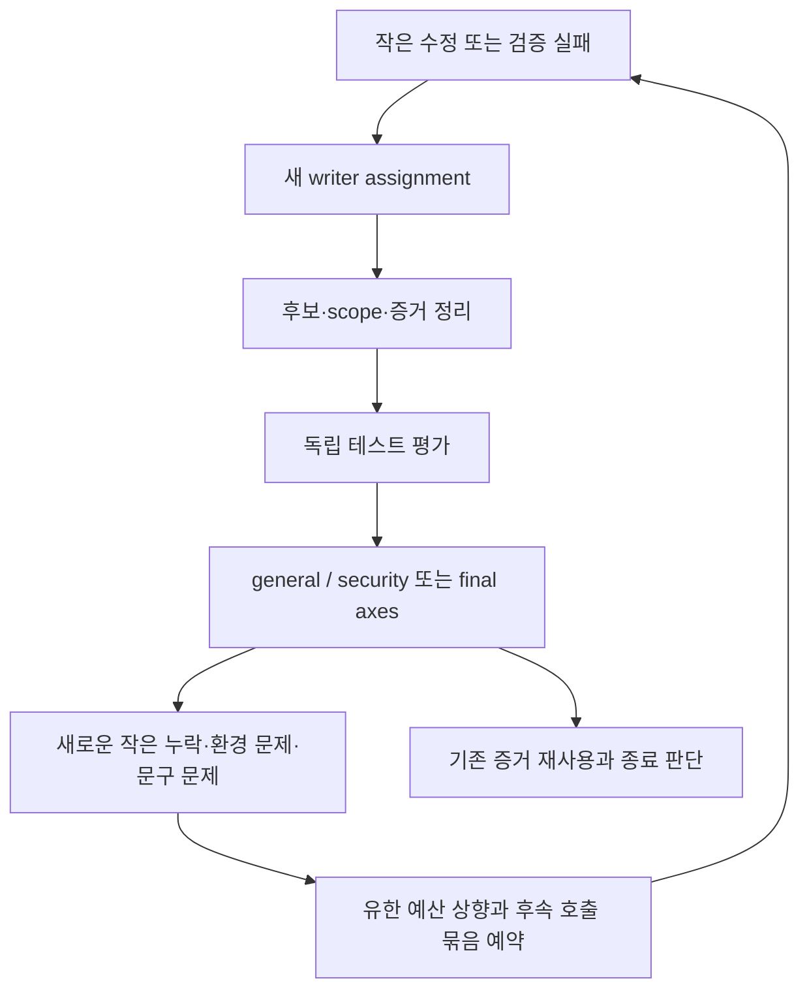

# Workbench 설치 기능 구현 중 과점검·과테스트 발생 분석

작성일: 2026-10-19, Asia/Seoul  
대상 실행: `.workflow/workbench-installation/runs/implement-20261019-01`  
대상 요청: `$implement docs/features/workbench-installation`  
보고서 요청: “현재 과점검 과테스트하는 문제를 원인과 과정을 분석해서 리포트 문서로 남겨줘 최대한 자세하게. 하네스를 고쳐야겠어.”  
문서 성격: 실행 기록에 근거한 사후 분석 및 하네스 개선 제안. 이 문서의 제안은 아직 구현하거나 새 정책으로 승인한 것이 아니다.

## 1. 핵심 판단

이번 실행은 실제로 과도해졌다. 다만 모든 테스트나 독립 리뷰가 불필요했던 것은 아니다. 원본 데이터를 손상할 수 있는 이관 문제, 실제 구버전 저장소를 이관하지 못하는 호환성 문제, 이력 변경을 막는 DB trigger를 검증하지 못하는 문제도 발견했다.

문제의 중심은 **검증의 필요성을 판단하는 일보다 검증 절차를 추가하는 일이 더 쉽게 일어나는 실행 구조**였다. Root는 작은 수정, 기존 테스트 fixture의 불일치, 검증 환경 오류까지 새로운 작업자·독립 검사·리뷰·증거 정리의 연쇄로 처리했다. 각 단계에는 개별적인 이유가 있었지만, 전체 비용과 종료 조건을 다시 판단하는 제어가 약했다.

기존 규칙에는 이미 “변경 영향만 재검증”, “유효한 기존 증거 재사용”, “변경 없는 리뷰 반복 금지”가 있었다. 따라서 규칙이 무조건 많은 테스트를 강제해서 벌어진 일로만 설명할 수 없다. **기존 절차의 과도한 세분화, 재사용에 소극적이었던 Root의 운영, 이를 제한하거나 가시화하지 못한 하네스**가 함께 원인이다.

가장 중요한 관측은 다음과 같다.

| 항목 | 관측 결과 | 해석상 주의 |
|---|---:|---|
| 승인 계획의 티켓 | 8개 | 설치·프로젝트 실행·이관·문서·최종 통합을 포함한 비교적 큰 범위였다. |
| 계획의 검증 단위 | 6개 | 단위별 검사 뒤 최종 전체 검사가 다시 배치됐다. |
| 최초 하위 호출 운영 추정 | 36회 | 사용자에게서 받은 강제 상한은 아니었다. |
| 실제 착수한 하위 호출 | 60회 | 실패·중단된 착수도 포함한다. 성공한 구현 작업 60개라는 뜻이 아니다. |
| 착수하지 않고 취소한 예약 | 5회 | I61–I65. 실제 실행 비용에 포함하면 안 된다. |
| 실제 착수 / 최초 추정 | 약 1.67배 | 호출 수의 비교이며 금액·토큰 비용의 비교가 아니다. |
| 도달했던 내부 총 호출 한도 | 66회 | 7차례 상향됐다. 무단으로 사용자 한도를 올린 사건은 아니다. |
| 독립 테스트 평가 + reviewer 호출 | 37회 / 60회 | 테스트 평가 14회, reviewer 23회. 전부 낭비라고 해석해서는 안 된다. |
| 첫 착수부터 마지막 종료 기록까지 | 약 8시간 13분 | 대기·Root 처리·병렬 작업이 포함된 경과 시간이다. CPU 사용 시간이나 유료 모델 실행 시간은 아니다. |
| 실행 최상위 JSON 기록 파일 | 612개 | 집계 시점의 운영 파일 수. 이 보고서 작성 중 추가 기록으로 이후 달라질 수 있다. |
| 그중 이름에 `request`가 든 JSON | 74개 | 모든 tool 호출 수를 뜻하지 않는다. |
| 최상위 patch 파일 | 28개 | 기록 생성량의 한 지표일 뿐, 모두 중복이라는 뜻은 아니다. |

보고서 시점에는 구현 검증을 중단하고 미착수 예약을 취소했다. 하네스 코드를 수정하거나 제품 테스트를 추가 실행하지 않고 이 분석 문서를 작성했다. 설치 기능 전체를 `done_verified`로 선언한 상태도 아니다.

## 2. 분석 범위와 증거의 한계

### 2.1 여기서 말하는 하네스

이 보고서의 하네스는 Workbench의 제품 테스트 스크립트만을 뜻하지 않는다. 다음을 묶은 실행 제어 체계를 뜻한다.

1. `AGENTS.md`와 `.codex/workflow-contract.md`의 개발·검증 규칙.
2. `.agents/skills/implement`, `change-verification`, `workflow-ledger`, `workspace-evidence`의 지시.
3. 승인된 `PLAN.json`, SPEC, 개별 티켓의 gate와 작업 범위.
4. Root가 만드는 assignment, 호출 예산, 수정·재검증 범위와 다음 작업 결정.
5. 하위 역할에 대한 host 제약, 명령 실행 wrapper, 결과 파일 전달 방식.
6. 실제 제품 테스트 환경과 실행 스크립트.

Root의 판단을 코드와 무관한 외부 요인으로 떼어내면 이번 문제를 설명할 수 없다. 현재 체계에서는 Root의 자연어 해석과 수동 JSON 작성이 상당 부분의 scheduler와 검증 정책 집행을 담당한다.

### 2.2 직접 확인한 자료

- 승인 계획: [PLAN.json](../features/workbench-installation/PLAN.json), [SPEC.md](../features/workbench-installation/SPEC.md), [WI-06](../features/workbench-installation/tickets/WI-06.md), [WI-08](../features/workbench-installation/tickets/WI-08.md).
- 호출 이력: [invocations.json](../../.workflow/workbench-installation/runs/implement-20261019-01/invocations.json), 보고서 집계 시 revision 297.
- 초기·중간·최종 후보 manifest와 scope audit.
- I46의 Git/wheel/sdist 설치·실행 receipt 및 artifact manifest.
- I47/I58/I59의 테스트·fixture 변경·실패 분류·독립 재검증 기록.
- I48/I49/I50의 최종 리뷰 결과와 당시 대화로 전달된 원본 결과.
- I60의 대화상 RED/GREEN 보고, 현재 파일 SHA-256, Root가 보존한 결과 전사.
- 예산 상향, 명령 실패, 예약 취소, 사용자의 제동 이후 실행 범위 조정 기록.
- 이번 분석을 위해 생성한 [집계 데이터](../../.workflow/workbench-installation/runs/implement-20261019-01/oververification-report-data.json).

### 2.3 이 보고서가 확정하지 않는 것

- 실제 청구 금액, 총 토큰 수, 역할별 금액과 CPU 사용량은 관측하지 못했다.
- 호출의 `starting`/`finished` 시각은 ledger 기록 시각이다. 실제 모델 실행 시작·종료와 완전히 같은 시각이라고 보장할 수 없다.
- 구성된 모델 이름·effort만으로 실제 host 실행 모델을 확정하지 않는다. 이를 근거로 특정 모델이 문제의 원인이라고 단정하지 않는다.
- 모든 과거 명령을 재실행하거나 모든 로그를 전수 분석한 것은 아니다. 분석을 위해 새 제품 테스트를 실행하지 않았다.
- `.workflow` 전체 용량을 이번 기능이 새로 만든 용량이라고 계산하지 않는다.
- I60의 전체 migration suite는 완료 footer와 종료 결과를 잃었다. 이 부분은 `partial/unknown`이며 pass로 간주하지 않는다.

이하에서는 **관측 사실**, **근거에 따른 원인 해석**, **향후 수정 제안**을 구분한다.

## 3. 원래 목표와 계획이 만든 작업 규모

### 3.1 사용자가 원한 동작

설치 개선 요청의 중심은 다음이었다.

- uv로 Workbench를 설치하고 실행한다.
- Workbench와 내장 skills를 연구 프로젝트의 소스·Python 환경과 분리한다.
- 프로젝트별 이력·DB·로그는 기본적으로 실행 프로젝트의 `.wb/`에 둔다.
- OMP는 `wb setup`이 점검하고, 없는 경우 설치를 준비한다.
- 기존 data-dir을 새 저장 방식으로 옮길 수 있게 한다.

마지막 이관 요구는 단순 파일 복사로 끝나지 않았다. 승인된 SPEC에는 원본 보존, WAL 포함 DB 일관성, writer 중단 확인, 과거 실행 권한 비활성화, 실패 대상의 완료 오인 방지까지 들어갔다. 따라서 이 실행이 작은 CLI 포장 작업에 불과했다고 보는 것도 부정확하다.

### 3.2 8개 티켓의 구조

| 티켓 | 내용 | 주요 검증 |
|---|---|---|
| WI-01 | 공식 OMP 배포와 SDK 실제 사용 가능성 판별 | 실제 bridge·child·writer 경로 |
| WI-02 | 독립 package와 자산 | noneditable 설치, 자산 closure, entry point |
| WI-03 | 프로젝트 식별과 durable/runtime 경로 | 초기화·탐색·충돌·Git 제외·권한·UDS |
| WI-04 | OMP setup transaction | 기존 선택 재사용, 미설치 처리, integrity, SDK |
| WI-05 | 프로젝트별 시작·재접속·CLI 호환 | A/B 격리, 실제 backend, detach/pause/shutdown |
| WI-06 | 원본을 보존하는 data-dir 이관 | writer 중단, DB·로그·session, 실패·race, 재오픈 |
| WI-07 | 사용자 문서 | 실제 CLI·실패 정책과 문서의 일치 |
| WI-08 | 최종 설치본 통합 검증 | 전체 acceptance, 독립 테스트 평가, Standards/Spec/security |

PLAN은 이를 U1–U6의 6개 검증 단위로 묶었다. U3는 WI-02/04, U5는 WI-06/07을 함께 다룬다.

### 3.3 계획 자체에서 비용을 키운 부분

**첫째, 기본 설치 개선과 까다로운 데이터 이관이 한 bundle에 들어갔다.** 설치·실행 개선의 사용 가치는 비교적 일찍 확인할 수 있지만, 이관은 SQLite 복구·파일 소유권·process identity·과거 권한 분리를 함께 요구한다. 향후 계획이라면 별도 delivery 단계로 나눌 여지가 있다. 다만 이번 보고서를 이유로 이미 승인된 이관 요구를 임의로 삭제하거나 낮추지는 않았다.

**둘째, 단위 검증과 최종 검증의 중복 범위가 넓다.** G-WI-02는 설치 자산, G-WI-05는 실제 setup, G-WI-06은 프로젝트 실행, G-WI-08은 실제 이관을 확인한다. WI-08은 다시 이들을 소비해 전체 사용자 흐름을 검증한다. 최종 결합 확인은 필요하지만, 어떤 기존 증거를 그대로 소비하고 무엇만 새로 실행할지는 실행자 해석에 크게 남아 있다.

**셋째, 문서 티켓도 모든 15 acceptance를 추적한다.** 이는 동작 테스트 15개를 다시 하라는 뜻이 아니다. 그러나 같은 표와 gate를 반복 추적하면서 문서 교정까지 큰 검증 절차로 보이기 쉽다.

**넷째, dependency와 묶인 검증 단위의 인계 조건이 충분히 구체적이지 않다.** WI-07은 WI-06에 의존하면서 둘은 U5에 묶여 있다. 실제 운영에서는 migration 선행 부분을 검사·리뷰한 뒤 문서를 만들고, 문서를 다시 독립 평가·리뷰했다. 이 과정을 전부 같은 후보를 반복 리뷰했다고 부를 수는 없지만, 원래 묶음의 효율이 살아나지 않은 것은 사실이다.

### 3.4 계획이 요구하지 않은 반복

[WI-08 검증·중단 조건](../features/workbench-installation/tickets/WI-08.md)의 43행은 prerequisite 실패 시 **“실패 원인 ticket으로 제한된 수정 후 affected 검증만 다시 수행”**하도록 한다.

[change-verification](../../.agents/skills/change-verification/SKILL.md)의 59–63행 역시 유효한 기존 coverage를 유지하고, 불확실한 영향이 있을 때만 이유를 기록해 전체 단위를 다시 보라고 한다. 변경 없는 리뷰 반복도 금지한다.

따라서 “티켓이 있었으니 수정 때마다 전체 검사와 설치 검증을 다시 준비할 수밖에 없었다”는 설명은 맞지 않는다. 실제로는 재사용을 더 적극적으로 선택했어야 한다.

## 4. 실제 실행의 정량적 모습

### 4.1 역할별 착수 횟수

| 역할 | 실제 착수 | 전체 대비 | 포함하는 일 |
|---|---:|---:|---|
| `worker_senior` | 16 | 26.7% | 구현, 실제 설치·실행, 복잡한 수정, 일부 fixture 보수 |
| `worker` | 4 | 6.7% | 문서 작성·교정, 마지막 이관 수정 |
| `test_designer` | 14 | 23.3% | 독립 요구 분석, 테스트 평가·추가·재검사, fixture 진단 |
| `reviewer` | 23 | 38.3% | general, Standards, Spec, security, 수정 부분 리뷰 |
| `oracle` | 3 | 5.0% | 구체적인 기술적 불확실성에 대한 조언 |
| 합계 | 60 | 100% | 취소된 5개 예약은 제외 |

독립 검사와 리뷰가 합쳐 61.7%였다. 이는 비용 구조를 보여주지만, 이 37회를 전부 제거할 수 있다는 뜻은 아니다. 반대로 “독립 역할이므로 그만큼 호출하는 것이 당연하다”는 설명도 충분하지 않다. 각 호출이 새로운 불확실성을 얼마나 줄였는지 따져야 한다.

### 4.2 예산이 늘어난 과정

초기 36회는 구현 7회, 독립 테스트 평가 5회, general review 6회, security review 2회, correction reserve 14회, oracle reserve 2회의 합인 운영 추정이었다. 처음부터 correction 여유 14회를 포함했다는 점에서, 단순히 “예비 수정 호출을 계획하지 않아서” 늘어난 것은 아니다. 이후 총 한도는 다음처럼 변했다.

`36 → 44 → 48 → 52 → 56 → 58 → 60 → 66`

각 상향에는 새 defect, 환경 중단, 필수 후속 검증 등의 이유가 기록돼 있다. 기록을 숨기거나 사용량을 초기화한 증거는 없다. 문제는 **각각 유한한 증액이 연속되면서 전체 비용 억제 장치로 작동하지 못했다**는 점이다.

특히 58회로의 상향 이유에는 두 문장의 문서 정확성 교정과 affected review가 포함됐다. 60회로의 상향에는 기존 fixture 보수와 독립 재평가가, 66회로의 상향에는 최종 리뷰에서 발견한 이관 결함 두 건의 수정·설치본 재검증·독립 검사·후속 리뷰 묶음이 들어갔다.

상향 자체는 현재 계약상 Root 권한이었다. 사용자 비용 상한을 어긴 사건으로 기록해서는 안 된다. 그러나 **권한 안에서 예산을 늘릴 수 있다는 것과 그 확대가 비례적인 판단이었다는 것은 별개**다.

### 4.3 단위별 누적 비용을 기계적으로 보기 어려웠다

착수한 60개 호출의 ledger `unit`과 `incident` 필드는 모두 빈 값이었다. assignment나 purpose에는 WI-U5, WI-06, defect 번호 등이 있었지만, ledger가 그 관계를 일관된 구조로 소비할 수 있는 형태는 아니었다.

현재 계약은 같은 이슈의 두 차례 worker 시도, 단위의 두 차례 corrective review 등을 **재평가 지점**으로 삼는다. 이들은 무조건 중단하거나 사용자 승인을 받으라는 상한은 아니다. 그래도 같은 문제에 이미 얼마나 투입했는지 볼 수 있어야 한다.

단위와 이슈의 연결이 자연어 purpose·개별 assignment·Root 기억에 흩어져 있으면 다음 질문을 자동으로 하기 어렵다.

- 지금 호출은 같은 이슈의 몇 번째 시도인가?
- 문서 교정 비용까지 원래 검증 단위의 누적 비용에 포함했는가?
- 새 unit 이름을 붙였을 뿐 같은 correction loop를 계속하는 것은 아닌가?
- 이번 추가 리뷰는 새 영향이 있는가, 아니면 종료 불안 때문에 반복하는가?

이는 ledger의 사용량 산술이 틀렸다는 뜻이 아니다. **정확한 호출 수 집계와 적절한 작업 선택은 다른 문제**다.

## 5. 과정별 재구성

시각은 Asia/Seoul이다. 세부 호출 번호는 예약 순서이므로 실행 시각과 항상 일치하지 않는다. 예를 들어 I35 문서 작업은 I34 이후 여러 이관 수정이 끝난 다음 실행됐다.

### 5.1 14:03–16:02: feasibility·project·package

- I01/I02에서 배포·SDK와 프로젝트 경로를 각각 시작했다.
- I03/I05에서 독립 평가를 했고, Git 제외와 버전 판정 등 실제 수정이 이어졌다.
- I06/I08/I09 및 I13/I14가 general/security 축을 확인했다.
- I11/I15가 독립 package와 설치 자산을 구현·검증했다.

이 단계에는 실제 공통 계약을 먼저 확인해야 할 이유가 있었다. 동시에 프로젝트 경로 하나의 correction이 worker → 독립 검사 → general/security로 다시 전개되는 비용 구조가 일찍 나타났다. 설치·경로·권한이라는 성격상 security 자체를 생략할 수는 없지만, 이후에는 최초 전체 검토와 변경 영향 검토를 명확히 분리해 재사용했어야 한다.

### 5.2 16:02–18:12: setup·프로젝트 lifecycle

- I16이 실제 OMP 준비와 SDK 확인을 포함한 setup을 구현했다.
- I17–I23에서 진단 경로, command ownership, 독립 검사 및 후속 general/security 검토를 처리했다.
- I24/I27–I33에서 실제 프로젝트 lifecycle과 startup/runtime/credential 경계를 구현·교정했다.
- I25는 별도로 기존 summary 테스트 fixture의 문제를 진단했다.
- I26은 entrypoint 격리의 구체적인 기술 문제에 대한 조언이었다.

여기서 설치 기능과 기존 safety net 보수의 두 흐름이 함께 진행되기 시작했다. 기존 회귀를 확인하는 것은 필요하지만, 기존 fixture 불일치를 어느 선에서 별도 부채로 남기고 어느 선에서 이번 acceptance에 필요한 수정으로 포함할지 더 일찍 제한했어야 한다.

### 5.3 18:12–20:34: 이관이 큰 별도 개발 문제로 확대

- I34가 migration을 구현했다.
- I36/I37/I38에서 독립 검사와 general/security 리뷰를 했다.
- 알려진 model 설정과 credential 비복사 경계에 대해 I39의 조언을 받았다.
- 실제 source 보존·불완전한 target 접근·SQLite 경로 race 문제 때문에 I40, I51, I52, I53으로 이어졌다.
- I41/I42/I43이 수정된 부분을 독립 평가·리뷰했다.

이 단계의 수정에는 실질적인 근거가 있었다. SQLite가 원본 또는 alias를 통해 source에 쓸 가능성을 제거하고, 순수 byte/WAL 처리와 memory SQLite·O_TMPFILE·FD publication으로 원본 보존을 만족시키려는 작업이었다.

따라서 이 시간 전체를 “쓸데없는 테스트”라고 기록하지 않는다. 다만 이관이 설치 개선 bundle 안에서 큰 기술 작업이 된 사실은 계획 단계에서 더 잘 드러났어야 한다. 이후 correction마다 필요한 검사와 기존에 입증된 순수 helper·runtime 축을 분리하는 결정도 더 빨랐어야 한다.

### 5.4 20:34–20:50: 문서 작업에 7개 호출

문서 관련 호출은 I35, I44, I45, I54, I55, I56, I57이었다.

| 호출 | 내용 |
|---|---|
| I35 | README와 설치본 skills 문서 작성 |
| I44 | 문서의 독립 요구·CLI 일치 평가 |
| I45 | 문서 general review |
| I54 | 누락된 실패 경계의 세 문단 교정 |
| I55 | 교정된 부분 review, 과도한 보장 문구 두 곳 발견 |
| I56 | 정확히 두 문자열 교체 |
| I57 | 그 두 문장의 affected review |

I55가 발견한 SDK 준비 보장과 cwd/root 표현의 부정확성은 실제 문서 문제였다. 그 문장을 고치는 것 자체는 필요했다. 그러나 이미 알고 있는 정확한 문구 두 곳을 바꾸기 위해 새 worker assignment와 별도 결과 파일·ledger·review·Root 정리를 계속 만드는 방식은 비용 대비 지나치게 잘게 나뉘었다.

이 구간에는 새로운 제품 동작이나 executable test가 필요하지 않았다. 실제 packet도 documentation TDD exception과 작은 diff 확인만 필요하다고 적었다. **작업의 위험도는 작게 분류했지만 호출과 증거 절차는 그만큼 작아지지 않은 사례**다.

### 5.5 20:50–21:48: 최종 설치 검증과 기존 fixture 보수

- I46은 실제 Git/wheel/sdist 설치와 lifecycle·이관·report를 확인했다.
- I47은 전체 관련 Python/TS safety net과 fixture 보수를 진행했다.
- TS는 28파일 171개가 통과했다. 여러 실행을 합성한 결과이며 단일 일괄 실행은 아니다.
- Python은 중간 합성 상태에서 609 PASS / 20 FAIL / 4 ERROR / 5 SKIP이었다.
- I58에서 8개 Python fixture 파일을 보완했고 79개 method가 통과했다.
- I59가 이를 독립적으로 다시 평가·실행해, 기존 638개 method ID를 보존한 633 PASS / 5 SKIP / FAIL·ERROR 0 상태를 만들었다. 별도의 class setup SKIP 1개는 유지됐다.

I47/I58의 실제 fixture 변경은 합쳐 18파일이었다. 입력 metadata, Worker 모델 이름, 필요한 `fixture.json`, 정확한 role/tool 목록, truthfully failed aggregate, descriptor와 연동 관측 기록의 일치 등이 포함됐다. 허용한 예외 이외의 assertion이나 제품 guard를 약화한 것으로 처리하지는 않았다.

그렇더라도 기존 safety net 보수가 현재 기능의 실행 시간을 크게 늘린 것은 사실이다. 동일 범위가 독립적으로 재검증됐다는 이유만으로 모든 재실행이 최선이었다고 정당화할 수는 없다. 요구에서 독립적인 기대값을 도출하고 기존 테스트를 평가하는 일과, 기존 실행을 통째로 다시 수행하는 일은 구분할 수 있었다.

### 5.6 21:48–22:16: 최종 리뷰의 실제 결함과 다시 커지려던 후속 계획

- I48 Standards와 I49 Spec은 실제 이전 버전의 `backend.json`에 `uid`가 없다는 점을 발견했다.
- I50 security는 같은 이름의 immutable trigger 본문이 바뀌어도 이관 schema 검사에 통과하는 점을 발견했다.
- I60에서 두 문제를 수정했다. Root는 추가로 `LIKE 'sqlite_%'`의 `_` wildcard 때문에 `sqlitex_extra`라는 일반 객체가 내부 객체로 누락되는 문제를 확인했다.
- I60은 세 경로의 공개 CLI RED→GREEN과 CHECK constraint 변조 거절을 보고했다. 새 테스트 모듈은 4개 method였다.
- 영향 migration 전체 suite는 wrapper에서 session ID·완료 footer를 잃어 `partial/unknown`이 됐다. Root가 전체 재실행을 제지했고, 작업자는 재실행하지 않았다.

이후 I61–I65로 현재 artifact 재생성·실제 실행·새 독립 검사·각 reviewer를 다시 배치하려 했다. **이 다섯 호출은 예약했지만 실행하지 않았다.** 사용자 지적 이후 취소했으므로 이미 발생한 60회와 합쳐 65회 실행했다고 쓰면 안 된다.

## 6. 구체적인 증폭 메커니즘

### 6.1 작은 correction이 작은 비용으로 끝나지 않았다

현재 구조는 새 구현의 검증 단위와 이미 검토된 구현에 대한 작은 correction을 같은 모양의 호출 절차로 다루기 쉽다.

문제는 A에서 H로 바로 갈 수 있는 조건이 약하게 적용됐다는 점이다. 새로운 위험이나 요구 공백이 있을 때는 반복이 필요하다. 그러나 문구 교정·검증 환경 수정·이미 입증된 변경 없는 축까지 같은 절차를 유지할 필요는 없다.

### 6.2 독립성 확보와 재실행이 결합됐다

`test_designer`의 목적은 worker 구현을 정답으로 삼지 않고 요구에서 기대값을 도출하는 것이다. 이는 중요하다. 하지만 독립성은 반드시 전체 명령을 한 번 더 실행해야만 생기는 것은 아니다.

현재 [change-verification](../../.agents/skills/change-verification/SKILL.md)은 기존 coverage 평가·재사용을 명시적으로 허용한다. 독립 관점에서 기존 테스트가 무엇을 놓치는지 검토하고, 필요한 반례만 추가하거나 실행하는 방식이 가능하다.

이번 실행에서는 독립 평가가 새로운 source lease·scope proof·module 재검사·원본 assertion 보존 증명으로 커지는 경우가 많았다. 특히 fixture를 보완하는 일이 본래 구현보다 큰 독립 작업처럼 취급됐다.

### 6.3 전체 candidate identity와 검증 입력 identity의 차이가 운영에서 부담이 됐다

전체 source candidate hash는 사용자 변경 보존, 동일 후보 확인, 감사에 유용하다. 그러나 테스트 파일 한 곳의 fixture 수정이나 root README 문구 변경만으로도 전체 candidate는 달라진다.

이때 다음 두 질문을 분리해야 한다.

1. 전체 작업 공간 후보가 달라졌는가?
2. 특정 runtime·artifact·review가 소비한 실제 입력이 달라졌는가?

실제로 I47/I58의 테스트 수정 후에는 I46의 canonical 126개 product/build 입력이 그대로였다. Root와 I59가 이를 확인해 실제 설치 실행을 재사용한 것은 적절했다.

마지막 I60 수정 뒤에는 상황이 달랐다. 이전 126개 canonical 입력 중 바뀐 것은 `src/workbench/backend/migrate.py` 하나였고, source 전체 delta는 이 파일과 새 회귀 테스트의 두 경로뿐이었다. 여기서도 영향을 받은 이관 경로만 다시 확인할 수 있었다. 실제 I61 purpose도 변경 없는 lifecycle 재사용을 명시했다. 따라서 마지막 후속 계획을 “전체 lifecycle을 모두 다시 실행하려 했다”고 기록하면 과장이다. 다만 Git/wheel/sdist 세 artifact를 모두 재생성하고 payload를 다시 연결하는 범위와 다섯 후속 역할 호출까지 필요한지는 더 좁게 판단할 여지가 있었다. 보고서 작성 직전에는 현재 wheel의 영향 경로 확인을 중심으로 줄이는 방향을 기록했다.

따라서 candidate hash를 없애야 한다는 결론이 아니다. **전체 후보 감사와 개별 증거의 유효성 판단을 별도로 제공해야 한다**는 결론이다.

### 6.4 기존 테스트의 불일치를 현재 기능의 필수 작업으로 크게 흡수했다

초기 진단 I25는 기존 summary fixture의 metadata·출력 경로·cap 기대값 문제를 구분했다. 이후 필요한 prerequisites, role 목록, 관측 기록의 pairing 등 더 많은 사례가 드러났다.

일부는 새 설치 환경에서 반드시 유지해야 하는 현재 acceptance와 직접 관련됐다. 일부는 기존 producer/guard와 fixture가 이미 맞지 않는 문제였다. 이를 모두 “새 기능이 만든 회귀”라고 할 수는 없다.

문제는 **기존 실패를 고쳐야 한다는 압력이 별도 범위·종료 조건 없이 커진 것**이다. 기존 실패를 무조건 무시하자는 뜻은 아니다. 다음을 일찍 판단했어야 한다.

- 이번 변경의 회귀인가?
- 현재 acceptance를 입증하는 데 필수적인 테스트인가?
- 그 behavior를 이미 더 직접적으로 확인한 증거가 있는가?
- 기존 fixture 부채로 별도 기록해도 이번 feature의 필수 수락 기준이 유지되는가?

이 판단 없이 “모든 기존 관련 테스트를 GREEN으로 만든 뒤 다음 단계”를 사실상의 목표로 삼으면, 기능 구현이 기존 테스트 정비 프로젝트로 바뀐다.

### 6.5 검증 환경 실패가 불필요한 재시도를 만들었다

| 사례 | 실제 원인 | 발생한 비용 | 더 작은 처리 |
|---|---|---|---|
| I47 긴 TMPDIR | native/Unix socket 경로 길이, `EINVAL`·abort 등 | 일부 실행 실패·분류·짧은 경로 재실행 | 시작 전에 짧은 private TMPDIR와 최소 연결 smoke 확인 |
| I47 Python module loader | sibling import가 되지 않는 실행 형태 | ERROR 후 discover 방식으로 재실행 | 지원하는 공통 unittest 진입점 고정 |
| I59 Node PATH | `/usr/bin:/bin` 격리 PATH가 필요한 Node 24를 제외 | 6개 setup ERROR 후 node-only 경로로 6개 재실행 | 실제 child가 소비할 PATH·Node를 한 번 사전 확인 |
| 실제 설치 검증의 harness 오기·전제 오류 | Git 옵션, 오프라인 build dependency, fake auth/models, shutdown 대기 등 | 여러 attempt와 진단 기록 | 환경 계약을 한 번 검증하고 결과를 재사용; 실패 subset만 수정 |

이 사례들은 제품 실패로 둔갑시키지 않고 환경·하네스 오류로 구분했다는 점에서는 올바르게 처리됐다. 그러나 분류를 정직하게 하는 것만으로 반복 비용이 사라지지는 않는다. 같은 사전 조건을 여러 담당자가 다시 잘못 준비할 수 있는 구조를 줄여야 한다.

### 6.6 명령 결과 수집 실패가 “확신을 얻기 위한 재실행”을 유발했다

Root는 한 formal check를 실행할 때 tool 반환 객체에서 `.output`만 취해 `session_id`를 전달받지 못한 적이 있었다. 그 check는 helper가 결과 파일을 남겼기 때문에 기존 결과를 찾아 재실행 없이 확인할 수 있었다.

I60에서도 wrapper가 session ID와 완료 footer를 잃었다. 작업자는 전체 suite를 다시 실행하려 했지만 Root가 중단시켰다. 이 경우에는 지속된 raw 결과가 없어 전체 suite를 `partial/unknown`으로 남겼다.

두 사례가 보여주는 핵심은 다음과 같다.

> 모델이 결과 핸들을 기억하고 있어야만 테스트 결과가 보존되는 실행 wrapper는, 결과를 잃을 때 같은 테스트를 다시 하도록 유도한다.

명령이 실제로 끝났는지 모른다면 pass로 꾸미면 안 된다. 동시에 확인을 위해 전체 suite를 무조건 다시 돌리는 것도 기본 해결책이면 안 된다. 결과 수집은 실행 시점에 지속되는 기록이어야 한다.

### 6.7 수동 프로토콜 작업이 제품 검증과 별도로 누적됐다

현재 Root는 많은 단계에서 assignment·request JSON·ledger update·snapshot·audit·check·결과 전사를 직접 조립했다. 이를 위한 구조 검증은 사용자 작업을 보존하는 장치이므로 제거할 대상은 아니다. 다만 수동 조립 자체가 또 다른 실패 원인이 됐다.

실제 사례:

- 예약 취소를 `finished`로 기록하려다 `reserved → cancelled`가 맞다는 오류를 받았다.
- 다음 요청에서 `cancelled` 상태에 `outcome: interrupted`를 넣어 거절됐다. `finished` 이외의 상태에서 outcome은 `null`이어야 했다.
- 두 실패 모두 preflight에서 ledger 변경 없이 거절됐다. 이후 올바른 취소 전이를 적용했다.
- 긴 assignment 생성용 Python 문법 오류도 있었다. 실행되지 않은 준비 작업이며 제품 테스트 실패가 아니다.

이는 검증 helper가 데이터를 잘못 변경한 증거가 아니다. 오히려 구조 검사가 잘못된 요청을 막았다. 문제는 Root가 이미 제공된 형식·전이를 반복해서 수동 재구성해야 하는 사용 방식이다.

[workflow-ledger skill](../../.agents/skills/workflow-ledger/SKILL.md)은 호출 기록을 두 단계의 command와 phase batch로 줄이라고 한다. 실제 운영에서는 `starting`, `running`, `finished`를 별도 요청 파일·결과로 관리하는 일이 많았다. 모든 추가 파일이 불필요한 것은 아니지만, 원래 지시의 비용 절감 취지가 충분히 실현되지 않았다.

### 6.8 결과 파일 계약이 지켜지지 않으면 앞선 엄격성이 무력해진다

I60 assignment에는 결과와 evidence 경로가 있었지만, 반환 시 해당 경로에서 결과를 확인하지 못했다. Root가 대화상 결과를 전사했고 source hash는 직접 확인했다. 그러나 실행 명령의 지속된 raw 결과를 새로 만들어낼 수는 없다.

I48/I49/I50 reviewer는 역할의 절대적인 read-only 제약 때문에 결과 파일도 쓰지 않고 JSON을 대화로 반환했다. Root는 이를 수동으로 전사했다. 읽기 전용 제약을 지키는 것은 옳지만, 전달 포맷을 parent가 다시 손으로 옮기는 과정은 불필요한 비용과 전사 오차 위험을 만든다.

**기본 실행 receipt와 결과 전달을 자동으로 보존하지 못한 채 manifest·scope 증명만 늘리는 것은 우선순위가 뒤집힌 상태**다.

### 6.9 검사 도구 설치 승인이 사용자에게 드러낸 절차 부담

사용자가 과점검을 지적하기 직전 대화에는 `pip-audit 2.10.1`을 이번 실행의 `tools/`에만 격리 설치하도록 허용하는 질문과 답변이 있었다. [설치 승인 기록](../../.workflow/workbench-installation/runs/implement-20261019-01/audit-tool-request.json)은 공식 PyPI wheel SHA-256 검증과 설치 범위를 남긴다. 앞선 문제 보고 기능에서는 `gitleaks`의 실행별 설치 허용 질문도 있었다. 이는 현재 실행의 60회 하위 호출에 이전 기능 호출까지 합산한다는 뜻은 아니다.

[security-review.md](../../.agents/skills/change-verification/references/security-review.md)는 manifest/lockfile 변경 시 dependency audit, 도구가 없으면 `not_run`, 도구 자동 설치 금지를 명시한다. 따라서 당시 설치 권한을 따로 확인한 것 자체는 읽은 규칙의 적용이었고, 사용자가 명시적으로 이번 실행에 한해 허용했다. 이 승인 질문을 임의로 무시했어야 한다는 결론은 아니다.

그러나 사용자가 원하는 설치·실행 개선과 별개로, 개발용 검사 도구의 다운로드·checksum·격리 설치·환경 보존까지 사용자가 승인해야 하는 경험이 누적됐다. 필수 검사라면 계획·환경 준비 때 필요한 도구와 지원 실행 방법을 먼저 판별하고, 허용된 실행 환경 안에서 한 번 준비한 도구를 재사용하는 편이 낫다. 이미 승인된 범위를 매 단계 다시 묻거나, 검사 도구를 준비하는 일을 별도 장기 프로젝트로 키우지 않아야 한다.

여기에는 두 가지를 분리할 필요가 있다. **독립 security review는 위험 경계를 검토하는 일이고, deterministic scanner는 정해진 입력에 도구를 실행하는 일**이다. 새 보안 finding이 없고 dependency 입력도 동일하다면 기존 audit 결과를 재사용할 수 있다. 제품 코드 변경으로 secret scan 입력이 달라진 경우는 새 입력을 검사하되, 이를 SDK·설치·lifecycle 전체 반복의 근거로 넓힐 필요는 없다.

## 7. 많은 테스트 뒤에도 실제 결함이 남았던 이유

### 7.1 기존 producer와 다른 “legacy” fixture

I48/I49가 확인한 사실은 다음과 같다.

1. 이전 HEAD의 `Backend._record()`는 최상위 `uid`를 기록하지 않는다.
2. 이관 테스트는 legacy fixture에 신규 `uid` 등을 넣었다.
3. 실제 live migration도 새 설치본으로 source를 생성했다.
4. `inspect_backend`는 UID가 없는 구형 기록에 fallback을 적용했지만, `migrate._stopped`는 `record.get('uid')`가 현재 UID여야 한다고 다시 요구했다.
5. DB writer 검사에도 같은 UID 소비 문제가 있었다.

따라서 “실제 구버전이 만든 저장소”라는 독립 기대값을 충분히 시험하지 못했다. 새 버전이 만든 상태를 legacy 위치에 놓고 성공하는 것을 반복 확인해도 이 문제를 잡지 못한다.

이 결함은 테스트 수를 늘리기보다 **fixture가 어떤 실제 producer 형식을 대표하는지 명시하는 것**으로 더 일찍 잡을 수 있었다.

### 7.2 같은 이름·열 구조와 같은 동작을 혼동한 schema 검사

I50은 메모리 DB에서 `task_specs_immutable_update`의 본문을 같은 이름의 `BEGIN SELECT 1; END`로 바꿨다. 기존 `_validate_task_schema`는 type/name과 `table_info`를 비교했기 때문에 통과했다. 이후 `task_specs.spec_json`의 UPDATE가 성공했다.

논리 row hash와 `integrity_check`는 현재 저장된 내용의 일관성에 도움이 되지만, 앞으로 이력을 변경하지 못하게 하는 trigger의 의미를 대신 검사하지 않는다. 따라서 이것도 더 많은 같은 종류의 데이터 복사 성공 테스트로 해결되지 않는다.

I60에서는 알려진 schema의 원문 `(type, name, tbl_name, sql)` 정의까지 비교하도록 보완했다. 추가로 `LIKE 'sqlite_%'`에서 `_`가 wildcard라서 일반 이름 `sqlitex_extra`를 제외하는 문제도 발견해 literal prefix를 다루는 `GLOB`로 바꿨다.

여기서 얻어야 할 교훈은 “검사를 더 많이”가 아니라 **입증하려는 불변식과 검사 방법이 맞는지 먼저 확인하라**는 것이다.

### 7.3 실제 결함을 과점검의 정당화로 사용하면 안 된다

두 결함은 수정할 가치가 있었다. 하지만 실제 결함이 나왔다는 사실이 다음을 증명하지는 않는다.

- 이전에 수행한 모든 재검사가 필요했다.
- 수정 후 변경 없는 SDK·프로젝트 lifecycle·설치 형식을 모두 다시 실행해야 한다.
- optional hardening까지 현재 완료 조건으로 올려도 된다.
- 유한 예산만 새로 설정하면 후속 절차 전체를 계속 확장해도 된다.

반대로 사용자 지적을 이유로 실제 수락 기준 위반을 숨기거나, 실행하지 않은 검증을 pass로 바꾸어서도 안 된다. 필요한 것은 테스트 철회가 아니라 영향 범위를 근거로 한 축소다.

## 8. 현재 규칙과 실제 운영의 차이

| 규칙 | 현재 문서의 의도 | 실제로 드러난 문제 |
|---|---|---|
| coherent unit별 독립 평가 | 작은 티켓은 정당하게 묶을 수 있음 | 단위가 일부 분리되고 correction마다 추가 호출이 붙음 |
| accepted correction은 affected axes | 유효한 원래 coverage 유지 | 새로운 전체 절차를 먼저 예약하는 경향 |
| unchanged review 반복 금지 | 입증된 축은 닫기 | 어떤 evidence를 닫았는지 Root가 수동으로 계속 재구성 |
| 최소 real probe 우선 | 핵심 불확실성만 먼저 판별 | environment 오류 이후 재검사 체계가 커짐 |
| 환경 실패는 제품 RED가 아님 | 원인 분류를 정확히 함 | 분류는 했으나 사전 준비 실패 자체는 반복됨 |
| finite operating budget | 필수 검증과 correction 여유를 계획 | 유한 증액이 연속돼 전체 팽창을 제한하지 못함 |
| 두 시도·두 review cycle 재평가 | 같은 문제에 대한 진행·방식 점검 | ledger의 unit/incident 연결이 비어 기계적인 누적 확인이 약함 |
| compact/batched accounting | 기록 비용을 작게 유지 | 수동 JSON·별도 요청·결과 파일·전사가 다수 발생 |
| Root는 종료 조건 판단 | 필수 coverage 충족 시 다음 단계·완료 | 절차 충족 자체가 추가 절차의 이유가 되는 경향 |

이 표의 상당수 문제는 규칙 부재보다는 **이미 있는 절약 규칙이 권고 수준의 자연어에 머무른 것**이다. “더 철저히 하라”는 문장을 추가하는 방식으로는 오히려 문제가 커질 수 있다.

## 9. 원인 분류

### 9.1 직접 원인: Root의 비례성 판단 실패 — 신뢰도 높음

Root는 작은 변경에 대해 필요한 최소 검증을 먼저 산출하기보다, 검증 단계 누락을 피하는 방향으로 새 호출을 배치했다. 두 문장의 문서 correction, 기존 fixture 보수, 마지막 migration 수정 후 여섯 호출 묶음 예약이 구체적인 사례다.

이는 사용자 요청이 없었기 때문이나, 사용자가 “충분히 빨리 끝내라”고 말하지 않았기 때문이 아니다. 권한 안에서 작업의 비용과 범위를 조절할 책임은 Root에 있었다.

### 9.2 구조적 원인: 기본 pipeline은 구체적이고 reuse는 해석에 의존 — 신뢰도 높음

역할, fresh context, frozen candidate, 증거 수준, scope 감사 등의 절차는 구체적이다. 반면 “이 기존 증거가 이번 변경에도 유효하므로 다음 단계를 생략한다”는 결정은 대체로 Root가 장문의 설명과 hash 증명으로 다시 만들어야 한다.

이 비대칭 때문에 재사용이 항상 싸고 쉬운 선택이 되지 못했다. 안전하게 보이는 기본값이 새 호출이 됐다.

### 9.3 구조적 원인: 예산이 사용량 통제보다 capacity 관리에 가까움 — 신뢰도 높음

현재 예산 규칙은 초과 dispatch, 사용량 초기화, 사용자 한도 우회를 막는 데 유용하다. 그러나 운영 한도를 정당한 이유로 계속 올릴 수 있어, 비용 대비 정보 가치가 작은 호출을 억제하는 장치와는 다르다.

단순히 hard cap을 넣으면 필수 검증 직전에 멈추거나 같은 작업을 다른 이름으로 옮기는 문제가 생길 수 있다. 필요한 것은 무조건적인 승인 대기가 아니라 **반복 비용과 새 정보의 비교를 강제하는 재평가**다.

### 9.4 기여 원인: 작업 범위가 크고 기존 테스트 부채가 함께 들어옴 — 신뢰도 높음

이관의 원본 보존 계약, 이전 CLI 호환, native SDK 검증, 독립 자산 layout이 서로 연결됐다. 여기에 이전 fixture의 drift가 합류했다. 모든 오류를 현재 기능 안에서 해결하는 쪽으로 처리하면서 범위와 수정 파일이 늘었다.

### 9.5 기여 원인: 준비·결과 수집이 담당자마다 달라짐 — 신뢰도 높음

Node/PATH/TMPDIR·unittest 진입점·SDK 실행 환경이 한 번 고정된 실행 계약으로 충분히 재사용되지 않았다. 명령의 session handle과 결과 파일도 일관되게 보존되지 않았다.

### 9.6 기여 원인: 여러 “현재 상태”와 큰 증거 문맥 — 신뢰도 중간

승인 문서의 역사적 draft 표기, 현재 `.workflow/state.json`, Root frontier, 호출별 assignment/result, 후보 manifest가 함께 존재했다. 이는 원래 역할이 다르지만, Root가 각 단계에서 현재 상태를 다시 설명하고 구형 후보의 증거와 구분하는 비용이 커졌다.

이번 분석에서 직접 확인한 최상위 JSON 612개·request 이름 파일 74개는 그 운영 부담의 단서다. 파일 수만으로 낭비량이나 토큰 비용을 산정할 수는 없지만, 상태를 수동으로 재구성하는 방식이 가볍지 않았음을 보여준다.

### 9.7 아직 입증하지 못한 원인

다음은 이 기록만으로 단정하지 않는다.

- 특정 모델의 능력·effort가 과점검의 원인이라는 주장.
- 실제 금액 중 몇 퍼센트가 낭비였다는 추정.
- 과거 모든 corrective review가 동일한 후보를 무의미하게 반복했다는 주장.
- ledger helper의 구조 검사가 잘못됐다는 주장.
- 데이터 보존·독립 security 자체가 불필요했다는 주장.
- 모든 기존 fixture 실패가 설치 기능과 무관했다는 주장.

## 10. 하네스 개선안

이 절은 수정 제안이다. 현재 제품 요구나 승인된 PLAN을 소급 변경하지 않는다. 새 workflow framework를 만들기보다 기존 규칙과 실행 도구를 작게 고치는 순서를 권한다.

### 10.1 P0: 다음 호출 전에 “무엇이 달라졌는가”를 먼저 결정

대상: `.agents/skills/implement/SKILL.md`, `change-verification/SKILL.md`, contract §7의 실행 결정 방식.

Root가 새 correction batch를 예약하기 전에 최소한 다음을 남기게 한다.

| 질문 | 필요한 답 |
|---|---|
| 변경한 product 입력은? | 실제 경로와 바뀐 계약·behavior |
| 영향받는 acceptance는? | 직접 연결되는 ID |
| 기존 증거 중 여전히 유효한 것은? | 이미 있는 결과와 영향 없음의 근거 |
| 새로 확인할 가장 작은 반례는? | 명령·사례·기대 결과 |
| 새 역할 호출이 필요한 이유는? | 기존 coverage·관찰만으로 부족한 부분 |
| 무엇이 확인되면 끝나는가? | 이 batch의 명시적인 성공·중단 조건 |

이것을 또 하나의 긴 문서로 만들자는 뜻은 아니다. 현재 assignment의 짧은 결정 부분으로 충분하다. 핵심은 **기본값을 전체 재검증에서 reuse+delta로 바꾸는 것**이다.

전체 단위를 다시 여는 경우에는 “새 후보라서”가 아니라 영향 불확실성이 무엇인지 적어야 한다. 기존 형식·현재 source hash가 같다면 불필요한 새 pipeline을 제안하지 않게 한다.

### 10.2 P0: 명령 결과를 모델 기억과 분리해 보존

대상: worker가 쓸 수 있는 bounded command 실행 경로, 기존 check 도구의 공통 실행 부분.

- 시작 전에 실행 ID, 명령, cwd, log 경로를 만든다.
- stdout/stderr는 처음부터 지속되는 파일에 쓴다. 민감한 값은 기존 redaction 경계를 따른다.
- 종료 코드·timeout·종료 여부를 모델이 나중에 기억해 적는 대신 실행기가 기록한다.
- 비동기 handle이 반환되면 그 handle도 기록한다. `.output`만 읽어도 실행 식별자를 잃지 않게 한다.
- 모델 호출이나 문맥이 끊겨도 같은 실행의 결과를 다시 읽을 수 있어야 한다.
- 결과가 없으면 `unknown`으로 유지하고 기존 실행부터 회수한다. 전체 suite 자동 재실행을 기본 복구로 삼지 않는다.

새로운 수십 개 상태 필드를 만들 필요는 없다. 이미 요구하는 argv/cwd/log/exit/timeout/프로세스 정리 정보를 일관되게 저장하는 작은 공통 실행 경로가 먼저다.

### 10.3 P0: budget 재평가를 실제 단위·이슈에 연결

대상: PLAN의 unit과 ledger의 기존 `unit`/`incident` 연결, contract §8 집행.

- 알려진 feature unit의 호출에는 해당 unit을 실제로 연결한다.
- 같은 defect의 수정·재시도·후속 리뷰를 하나의 누적 이력으로 볼 수 있게 한다.
- 이미 있는 “두 worker 시도·두 corrective review cycle” 지점에서 이력 요약과 더 작은 대안 선택을 요구한다.
- 예산 상향 시 “남은 필수 절차가 있다”만 적지 말고, 기존 절차를 합치거나 재사용해도 되는지 먼저 판단한다.
- 합리적인 진행이 있으면 계속할 수 있다. 다만 그 사실이 전체 절차의 반복을 자동 정당화하지 않게 한다.
- 사용자의 명시적 시간·비용 한도는 별도 hard constraint로 유지한다.

이 변경은 모든 예산 상향마다 사용자 승인을 받자는 제안이 아니다. 사용자를 반복 승인자로 만드는 대신 Root의 비례성 판단을 확인 가능한 형태로 만든다.

### 10.4 P1: 문서·fixture·environment correction의 경로를 작게

대상: correction 분류와 독립 평가 범위.

| correction 종류 | 기본 방향 |
|---|---|
| 문서의 정확한 두 문장 교정 | 실제 동작과 diff 확인, 필요한 affected review. 새 runtime·새 테스트 코드 불필요 |
| fixture 입력만 보완 | 원래 assertion·제품 guard 보존 확인, 바뀐 helper가 영향을 주는 사례만 실행 |
| Node/PATH/TMPDIR 오류 | 실행 환경 수정 후 실패 subset. 제품 코드 수정·전체 독립 pipeline 재시작 불필요 |
| migration owner/schema 동작 수정 | 공개 regression과 source 보존, 설치된 해당 동작 확인, 관련 security delta 유지 |
| packaging resolver·entrypoint 변경 | source-independent 설치·자산 검증을 실제로 다시 열어야 함 |

작은 파일 수만으로 안전하다고 판단해서는 안 된다. 반대로 risk signal 하나가 있다고 모든 무관한 검증 축을 다시 열어서도 안 된다.

### 10.5 P1: 독립 테스트 평가와 실행을 분리

대상: `test_designer` assignment와 결과 계약.

독립 담당자는 먼저 요구에서 기대값을 도출하고 기존 테스트·실행이 무엇을 입증하는지 평가한다. 그다음 부족한 반례만 추가하거나 실행하도록 한다.

다음 두 결과를 모두 정상적인 완료로 취급해야 한다.

- “이 기존 테스트와 원시 결과가 이 변경을 충분히 덮는다. 새 실행은 X 한 사례만 필요하다.”
- “현재 coverage에 중요한 공백이 있어 새 반례 Y가 필요하다.”

새 테스트 파일·전체 module 재실행이 항상 있어야 독립 평가가 성립한다는 암묵적 기대를 제거한다. worker GREEN을 무비판적으로 받아들이자는 뜻은 아니다.

### 10.6 P1: read-only reviewer 결과를 자동 보존

대상: parent dispatcher와 reviewer 결과 전달.

reviewer의 source read-only 제약은 유지한다. 결과는 host/parent가 원문 그대로 지정된 evidence 위치에 보존하고, Root는 그 파일을 검토해야 한다. Root가 대화 JSON을 다시 요약·전사하는 것을 기본 경로로 삼지 않는다.

이렇게 하면 역할 제약을 어기지 않으면서도 provenance와 구체적인 finding을 잃지 않을 수 있다.

### 10.7 P1: 대표 fixture의 producer를 명시

대상: compatibility/migration 회귀 설계와 계획의 catches/misses.

- “legacy”라는 이름만으로 실제 이전 버전을 대표한다고 가정하지 않는다.
- 어떤 producer 버전·형식에서 온 fixture인지 적는다.
- 새 버전이 만든 fixture에서 신규 필드를 제거한 경우에는 그렇게 합성한 것임을 명시한다.
- 원래 없던 필드를 테스트 setup에서 편의상 채웠다면, 그로 인해 놓치는 호환성 경계를 표시한다.
- 데이터의 현재 값과 미래 변경을 막는 제약·trigger를 구분해 확인한다.

이번에 실제 결함을 잡은 핵심은 이 두 가지 관점이었다. 같은 성공 흐름을 반복하기보다 이런 대표성 공백을 찾는 것이 더 큰 가치를 줄 수 있다.

### 10.8 P2: 현재 상태와 역사적 증거의 읽기 비용 축소

대상: `.workflow`의 current state/frontier와 결과 index.

- 현재 task mode, source candidate, active 호출, 실제 blocker, 다음 한 작업을 작은 단일 current record로 제공한다.
- 이전 단계의 next-action 문구를 현재 record에 계속 남겨 서로 충돌시키지 않는다.
- 승인 문서와 이전 결과는 역사로 보존하고 현재 기록에서 참조한다.
- 전체 manifest를 모델 문맥에 넣지 않고 변경 경로·관련 입력 signature·기존 증거 유효성만 요약한다.
- 변경 없는 기존 증거를 새 pass로 재라벨링하지 않는다.

기록을 삭제하거나 실패를 감추자는 뜻이 아니다. 보존량과 모델이 매번 읽어야 하는 양을 구분하자는 뜻이다.

### 10.9 P2: 프로토콜 조립은 helper가 맡고 Root는 판단에 집중

대상: assignment/dispatch/result accounting의 얇은 사용 계층.

- `reserved → cancelled` 같은 알려진 전이에 맞는 요청을 생성하게 한다.
- 실행하지 않은 예약 취소와 시작한 작업의 중단을 구분한다.
- phase batch를 기본으로 사용해 동일 내용을 여러 파일로 수동 재작성하지 않는다.
- 잘못된 요청은 현재처럼 mutation 전에 거절하되, 다음에 쓸 올바른 최소 형식을 쉽게 제공한다.
- role/model의 실제 관측 여부를 계속 분리한다.

이 부분은 새로운 orchestration framework를 만드는 프로젝트가 되어서는 안 된다. 현재 드러난 수동 오류와 중복 기록 생성부터 줄이는 작은 변경이 적합하다.

### 10.10 P1: 검사 도구 준비와 검사 결과 재사용을 분리

대상: `security-review.md`의 도구 preflight와 dependency/secret 입력 추적.

- manifest 변경이 있는 실행에서는 필요한 audit 도구·실행 경로·네트워크 조건을 초기에 한 번 확인한다.
- 설치가 필요하고 기존 규칙상 별도 허용이 필요한 경우, 실제 설치 범위와 검증 방법을 구체화해 한 번 요청한다. 사용자 허용 범위를 넘는 전역 설치나 새로운 자동 설치 권한을 추론하지 않는다.
- 도구가 준비되면 같은 실행 안에서 재사용한다. 검사마다 도구 준비를 다시 만들지 않는다.
- audit은 실제 dependency closure가 달라졌는지, secret scan은 검사할 source 입력이 달라졌는지로 재실행을 결정한다.
- 도구 부재·네트워크 차단·timeout을 제품 결함과 구분하고, `not_run`과 남은 수락 기준을 명확히 보고한다.

이것은 보안 검사를 없애자는 제안이 아니다. 현재의 설치 금지·승인 경계를 지키면서도 사용자에게 보이는 도구 준비 부담과 변경 없는 검사 반복을 줄이자는 제안이다.

## 11. 하네스 수정 후 확인할 최소 수락 시나리오 제안

아래는 향후 하네스 변경의 기대 동작이다. 이 보고서 작성 과정에서 실행한 테스트 목록이 아니다.

| 입력 상황 | 하네스가 선택해야 할 결과 |
|---|---|
| 검토된 README의 두 문장만 수정 | 제품 runtime·설치 재실행을 선택하지 않고 문서 diff/실제 동작의 affected 확인 |
| 테스트 fixture만 바뀌고 canonical product 입력은 동일 | 기존 runtime 증거 유지, 해당 assertion·fixture 영향만 검사 |
| migration 모듈의 owner/schema 검사만 변경 | 관련 공개 회귀·source 보존·설치본 해당 경로 확인. SDK·A/B lifecycle 전체 재실행은 근거 없이 선택하지 않음 |
| entrypoint나 asset resolver 변경 | source-independent 실제 설치 검증을 다시 선택 |
| 검증 PATH에 Node가 없음 | environment 분류, 작은 준비 확인 후 실패 subset만 재실행 |
| 비동기 session handle을 모델이 놓침 | 지속된 실행 receipt에서 결과 회수. 전체 suite 자동 재실행 금지 |
| reviewer가 파일을 쓸 수 없음 | host/parent가 원문 결과 자동 저장, source write 권한 확대 없음 |
| 같은 issue의 corrective cycle이 누적됨 | 누적 이력·새 정보·더 작은 방법을 먼저 제시. unit 이름 변경으로 이력을 초기화하지 않음 |
| 실제 새로운 acceptance 위반 발견 | bounded fix와 필요한 regression/security 수행. 과점검 방지 명목으로 숨기지 않음 |
| required coverage가 충분하고 변경 영향이 닫힘 | optional hardening·변경 없는 리뷰를 추가하지 않고 종료 |
| 사용자가 분석 보고서만 요청 | 미착수 구현 검증 취소, 제품·하네스 코드 수정 없이 보고서 작성 |

이 시나리오를 확인하기 위해 새로운 대규모 native 통합 환경부터 만들 필요는 없다. 먼저 계획 선택·실행 receipt·취소 전이의 작은 사례로 제어 동작이 달라지는지 확인하면 된다.

## 12. 현재 설치 기능의 정확한 중단 상태

### 12.1 제품 구현과 후보

- WI-01–WI-07은 앞선 실행에서 통합·검증 기록이 있다.
- WI-08 최종 완료는 선언하지 않았다.
- 마지막 수정 후보는 `bce5a954c97c197790e1b143230f5d7843dcf7eb441d11577be8bd8371840cd3`이다.
- 직전 최종 리뷰 후보 `7b4f3da006630940ca009a57428aa0a9d0cf4ee7df6d9cae8204566149c7d7c8`와 비교한 실제 source delta는 다음 두 파일이다.
  - `src/workbench/backend/migrate.py`
  - `tests/backend/installation/test_migration_compatibility.py`
- index는 이전과 동일하다. 이 보고서 작성은 별도의 사용자 요청 문서 변경이다.

### 12.2 무엇이 확인됐고 무엇이 남았는가

| 내용 | 상태 |
|---|---|
| 이전 후보의 Git/wheel/sdist 실제 설치·사용 흐름 | 기록 존재. 당시 입력에 대한 증거이며 마지막 수정 후보의 전체 fresh 실행으로 바꾸어 말하지 않음 |
| 이전 후보의 TS 171개 | 합성 PASS, 마지막 migration 수정 뒤 TS를 재실행하지 않음 |
| 이전 후보의 Python 638 method ID | 합성 633 PASS / 5 SKIP, 별도 class SKIP 1개 |
| I60 새 회귀 4개 | 대화상 PASS 보고, source hash 확인. 지정 evidence/raw 파일 부재 한계 있음 |
| I60 전체 영향 migration suite | `partial/unknown`: session/footer 유실, 반복 실행하지 않음 |
| 두 최종 finding의 코드 수정 | 후보 존재. independent final acceptance가 끝났다는 뜻은 아님 |
| 마지막 후보의 affected 설치본 확인·독립 검토 | 이 분석 요청으로 중단, 실행하지 않음 |
| I61–I65 | 전부 미착수 취소 |
| 현재 하위 호출 | ledger상 active 0 |
| 커밋·푸시·사용자 저장소 이관 | 이번 분석에서 수행하지 않음 |

### 12.3 추후 재개한다면 최소 범위

분석 요청 직전 좁힌 범위는 다음이었다. 이는 지금 실행 중인 작업이 아니다.

1. 새 회귀 4개와 실제 변경 diff를 독립적으로 확인한다. 기존 관련 전체 suite를 자동 반복하지 않는다.
2. 현재 wheel을 사용해 구형 기록 이관과 변조 schema 거절을 확인한다. 변경 없는 설치 형식·SDK·전체 lifecycle 증거는 영향 근거와 함께 재사용한다.
3. 기존 전체 Standards/Spec coverage를 유지하면서 이관 delta의 general/보안 검토를 한다. 검증하지 않은 부분은 그대로 남긴다.
4. 현재 변경·증거 연결과 source/process 정리를 확인한 뒤 완료 여부를 판단한다.

기존 코드가 충분히 검증됐다고 꾸미거나, 이미 실행한 검증을 버리고 처음부터 다시 하는 두 극단 모두 피해야 한다.

## 13. 이 보고서 작성 자체의 범위

이 분석에서도 같은 문제를 반복하지 않기 위해 다음 경계를 적용했다.

- 하위 agent를 새로 호출하지 않았다.
- 제품 테스트·SDK·OMP·설치·dependency audit·secret scan을 새로 실행하지 않았다.
- 승인된 BRIEF/SPEC/PLAN/ticket의 bytes를 고치지 않았다.
- 제품 코드나 workflow 하네스 코드를 수정하지 않았다.
- 기존 기록을 읽고 집계했으며, 미착수 예약 취소와 현재 분석 상태를 기록했다.
- 보고서의 숫자·상대 링크·자료 경로를 확인하는 문서 검증만 수행한다.

이 문서는 “검증이 많으니 무조건 줄이자”는 보고서가 아니다. **어떤 변경이 어떤 불확실성을 새로 만들었는지에 비례해 검증을 선택하고, 이미 입증한 사실은 재사용하며, 필요한 사실이 확인됐으면 끝낼 수 있는 하네스로 바꾸자는 보고서**다.

## 부록 A. 핵심 증거 찾아보기

| ID | 자료 | 이 보고서에서 사용하는 내용 |
|---|---|---|
| E01 | [PLAN.json](../features/workbench-installation/PLAN.json) | 8 tickets, 6 units, 최초 36회 추정, 11 gates |
| E02 | [WI-08](../features/workbench-installation/tickets/WI-08.md) | 최종 검증과 43행 affected-only 원칙 |
| E03 | [SPEC](../features/workbench-installation/SPEC.md) | safety net, runtime, source 보존, schema 거절, final review |
| E04 | [호출 ledger](../../.workflow/workbench-installation/runs/implement-20261019-01/invocations.json) | 60회 착수·5회 취소, 시각·역할·예산 상향 |
| E05 | [보고서 집계](../../.workflow/workbench-installation/runs/implement-20261019-01/oververification-report-data.json) | 재현 가능한 호출·역할·단위 빈 값 집계 |
| E06 | [change-verification](../../.agents/skills/change-verification/SKILL.md) | 독립 평가와 reuse, affected review, unchanged review 금지 |
| E07 | [implement](../../.agents/skills/implement/SKILL.md) | smallest probe, coherent unit, correction, integration |
| E08 | [workflow-ledger](../../.agents/skills/workflow-ledger/SKILL.md) | 기록은 권한·host truth가 아님, batching, 운영 한도 |
| E09 | [workspace-evidence](../../.agents/skills/workspace-evidence/SKILL.md) | manifest/checkpoint 구분, source/index 보존 |
| E10 | [공유 계약](../../.codex/workflow-contract.md) | §7 reuse와 delta, §8 finite budget·재평가 지점. 분석 시 해당 절만 helper로 읽음 |
| E11 | [I47 결과](../../.workflow/workbench-installation/runs/implement-20261019-01/WI-I47-result.json) | 초기 현재 TS/Python 상태, 환경 문제, 미결정 실패 |
| E12 | [I58 결과](../../.workflow/workbench-installation/runs/implement-20261019-01/WI-I58-result.json) | 8개 fixture 보수·79개 통과·원래 실패 보존 |
| E13 | [I59 결과](../../.workflow/workbench-installation/runs/implement-20261019-01/WI-I59-result.json) | 독립 79개 재검사, 638 IDs 합성, Node PATH 오류 |
| E14 | [I48 Standards](../../.workflow/workbench-installation/runs/implement-20261019-01/WI-I48-result.json) / [I49 Spec](../../.workflow/workbench-installation/runs/implement-20261019-01/WI-I49-result.json) | 실제 이전 producer의 UID 부재 finding. Root 구조화 전사라는 provenance 포함 |
| E15 | [I50 security](../../.workflow/workbench-installation/runs/implement-20261019-01/WI-I50-result.json) | immutable trigger 본문을 놓치는 schema 검증 finding. Root 구조화 전사 |
| E16 | [내부 prefix probe](../../.workflow/workbench-installation/runs/implement-20261019-01/schema-internal-prefix-probe.json) | `sqlitex_extra`가 잘못 제외되는 실제 memory 관측 |
| E17 | [I60 결과 전사](../../.workflow/workbench-installation/runs/implement-20261019-01/WI-I60-result.json) | 마지막 두 파일·4개 회귀 보고, raw/전체 suite 증거 유실 한계 |
| E18 | [실행 범위 조정](../../.workflow/workbench-installation/runs/implement-20261019-01/execution-proportionality-adjustment.json) | 사용자 지적 후 전체 반복 축소, 미착수 취소 |
| E19 | [보고서 작업 범위](../../.workflow/workbench-installation/runs/implement-20261019-01/oververification-report-scope.json) | report-only 전환과 구현 검증 중단 |
| E20 | [보고서 요청 후 취소 기록](../../.workflow/workbench-installation/runs/implement-20261019-01/report-task-reconcile-ledger.json) | revision 297, active 호출 0 |

아래 부록은 ledger에서 추출한 시각과 원문 purpose를 포함한다. 원문의 약어·띄어쓰기와 역할 이름을 유지했으며 전체 집계는 E04/E05에 남아 있다. 각 호출의 상태가 `finished`여도 해당 제품 기능이 pass라는 뜻은 아니다.

## 부록 B. 전체 호출 목록

모든 시각은 2026-10-19 Asia/Seoul이다. 번호순이며 실행 시각순이 아니다. `finished`는 호출 정산 상태로서 테스트 PASS와 구분한다. 60개 착수 호출의 `unit`·`incident`는 모두 빈 값이었다.

| ID | 역할 | 착수 | 종료 또는 취소 | 상태 | ledger purpose 원문 |
|---|---|---|---|---|---|
| WI-I01 | worker_senior | 14:03:51 | 14:16:35 | finished | WI-01 implementation/probe |
| WI-I02 | worker_senior | 14:03:51 | 14:12:09 | finished | WI-03 implementation/probe |
| WI-I03 | test_designer | 14:12:26 | 14:15:24 | finished | Independent WI-U2 project/runtime tests |
| WI-I04 | worker_senior | 14:15:44 | 14:16:45 | finished | WI-03 correction WI-DEF-01 |
| WI-I05 | test_designer | 14:17:26 | 14:22:12 | finished | Independent WI-U1 recipe/probe assessment |
| WI-I06 | reviewer | 14:17:26 | 14:20:12 | finished | Frozen WI-U2 Standards/Spec general review |
| WI-I07 | worker_senior | 14:22:28 | 14:24:13 | finished | WI-01 correction WI-DEF-02 valid existing version |
| WI-I08 | reviewer | 14:24:53 | 14:28:15 | finished | Frozen WI-U1 general Standards/Spec review |
| WI-I09 | reviewer | 14:24:53 | 14:28:15 | finished | Separate WI-U2 security review filesystem/Git/runtime |
| WI-I10 | test_designer | 14:29:52 | 14:34:04 | finished | Independent WI-DEF-03 marker-publication race regression |
| WI-I11 | worker_senior | 14:31:35 | 14:52:11 | finished | WI-02 standalone package/assets and tool installation |
| WI-I12 | worker_senior | 14:34:25 | 14:39:55 | finished | WI-03 fd-anchored/no-clobber security correction WI-DEF-03 |
| WI-I13 | reviewer | 14:42:06 | 14:47:08 | finished | WI-03 affected general security-correction delta review |
| WI-I14 | reviewer | 14:42:06 | 14:47:08 | finished | WI-03 affected security security-correction delta review |
| WI-I15 | test_designer | 14:52:25 | 15:00:03 | finished | WI-02 independent package/installed asset assessment before setup consumer |
| WI-I16 | worker_senior | 15:02:31 | 15:35:30 | finished | WI-04 transactional setup existing OMP reuse/managed stable install/SDK readiness within WI-U3 |
| WI-I17 | test_designer | 15:36:21 | 15:45:25 | finished | WI-U3 independent setup transaction/installed actual evidence assessment |
| WI-I18 | worker_senior | 15:45:25 | 15:48:06 | finished | WI-DEF-06 preserve effective saved-selection path diagnostic |
| WI-I19 | reviewer | 15:50:04 | 15:54:04 | finished | WI-U3 fresh combined general Standards/Spec review after correction |
| WI-I20 | reviewer | 15:50:04 | 15:54:04 | finished | WI-U3 separate security review after correction |
| WI-I21 | test_designer | 15:54:04 | 15:59:29 | finished | WI-DEF-07 assertion-preserving independent command harness ownership correction |
| WI-I22 | reviewer | 16:00:35 | 16:02:39 | finished | WI-U3 affected general delta after test harness-only correction |
| WI-I23 | reviewer | 16:00:35 | 16:02:39 | finished | WI-U3 separate security delta after test harness-only correction |
| WI-I24 | worker_senior | 16:02:39 | 17:01:16 | finished | WI05 project start/attach identity isolation and actual lifecycle integration |
| WI-I25 | test_designer | 16:04:07 | 16:14:55 | finished | Bounded historical WI-OBS-01 fixture diagnosis, no WI08 implementation or gate claim |
| WI-I26 | oracle | 16:32:45 | 16:35:43 | finished | Concrete bounded entrypoint isolation design blocker, advice only, not implementation/planning ownership |
| WI-I27 | test_designer | 17:01:58 | 17:09:36 | finished | Independent requirement-derived WI05 public CLI/lifecycle/import-isolation coverage assessment and gaps only |
| WI-I28 | reviewer | 17:11:40 | 17:16:20 | finished | WI05 fresh general review of frozen full16path unit |
| WI-I29 | reviewer | 17:11:40 | 17:16:20 | finished | WI05 fresh security review of frozen full16path unit |
| WI-I30 | worker_senior | 17:17:23 | 17:53:55 | finished | WI05 coupled DEF08/09/10 correction and portable G06 recipe |
| WI-I31 | test_designer | 17:54:39 | 18:07:18 | finished | Independent assessment of corrected credential/startup/runtime identity behavior |
| WI-I32 | reviewer | 18:09:35 | 18:12:14 | finished | WI05 affected general review for three required corrections |
| WI-I33 | reviewer | 18:09:35 | 18:11:48 | finished | WI05 affected security review of corrected identity and startup boundary |
| WI-I34 | worker_senior | 18:12:46 | 19:21:59 | finished | WI06 migration coupled invariants implementation |
| WI-I35 | worker | 20:34:13 | 20:40:43 | finished | WI07 bounded operational docs after migration implementation |
| WI-I36 | test_designer | 19:22:34 | 19:27:47 | finished | WI-U5 independent migration/docs assessment |
| WI-I37 | reviewer | 19:28:19 | 19:31:24 | finished | WI-U5 fresh general Standards+Spec |
| WI-I38 | reviewer | 19:28:19 | 19:31:24 | finished | WI-U5 migration security |
| WI-I39 | oracle | 19:03:44 | 19:07:10 | finished | Concrete migrated custommodels durable config vscredential no-copy contract technical blocker |
| WI-I40 | worker_senior | 19:31:56 | 19:37:37 | finished | WI06 required DEF12/13 bounded reproduction+TDD correction/currentinstalledG08 |
| WI-I41 | test_designer | 20:21:05 | 20:30:14 | finished | WI06 DEF12/13 independent requirement-first reassessment |
| WI-I42 | reviewer | 20:31:01 | 20:33:49 | finished | WI06 affected general Standards/Spec delta |
| WI-I43 | reviewer | 20:31:02 | 20:33:49 | finished | WI06 affected separate security delta |
| WI-I44 | test_designer | 20:41:08 | 20:43:27 | finished | WI07 docs independent CLI/requirements assessment |
| WI-I45 | reviewer | 20:41:08 | 20:43:27 | finished | WI07 affected general Standards/Spec docs review |
| WI-I46 | worker_senior | 20:50:06 | 21:04:36 | finished | WI08 final installed Gitref/wheel/sdist wholeflow integration |
| WI-I47 | test_designer | 21:05:28 | 21:33:10 | finished | WI08 final independent assessment +bounded historicalfixturemaintenance |
| WI-I48 | reviewer | 21:48:44 | 21:57:50 | finished | Final feature fresh Standards |
| WI-I49 | reviewer | 21:48:44 | 21:57:50 | finished | Final feature fresh Spec |
| WI-I50 | reviewer | 21:48:44 | 21:57:50 | finished | Final feature fresh separate security |
| WI-I51 | worker_senior | 19:38:26 | 19:40:46 | finished | Resume bounded WI06 data-preserving DB normalization correction after host interruption |
| WI-I52 | oracle | 19:38:26 | 19:44:25 | finished | Read-only concrete stdlib SQLite pinned-input WAL recovery design blocker |
| WI-I53 | worker_senior | 19:44:25 | 20:18:56 | finished | WI06 fixedDBWAL byteimage +memorySQLite data-preservation correction after concrete APIadvice |
| WI-I54 | worker | 20:43:27 | 20:45:32 | finished | WI07 bounded threeboundary docs correction |
| WI-I55 | reviewer | 20:46:05 | 20:47:47 | finished | WI07 affectedgeneral docs boundary correction |
| WI-I56 | worker | 20:47:47 | 20:48:55 | finished | WI07 exacttwo-sentence docprecision fix |
| WI-I57 | reviewer | 20:49:12 | 20:50:06 | finished | WI07 finalaffected exacttwo-sentence generalreview |
| WI-I58 | worker_senior | 21:33:10 | 21:42:15 | finished | Coupled recovery/restart fixture correction and readonly status-seam diagnosis |
| WI-I59 | test_designer | 21:42:26 | 21:48:44 | finished | Fresh independent requirement-derived assessment of eight repaired fixturemodules; preserve638case coverage and currentrawreuse |
| WI-I60 | worker | 21:57:50 | 22:16:55 | finished | Bounded legacyUID2consumer + supportedschema semantic guards TDD fix |
| WI-I61 | worker_senior | — | 22:16:55 | cancelled | Current3artifact regen/noneditablepayload binding and affected actuallegacy migration/schemafail delta, explicitunchangedlifecycle reuse |
| WI-I62 | test_designer | — | 22:17:55 | cancelled | Fresh independent legacyUID/schema publicregression andcurrentartifact delta assessment |
| WI-I63 | reviewer | — | 22:17:55 | cancelled | Fresh affectedStandards oldwholecoverage reuse +2guard delta/currenttests |
| WI-I64 | reviewer | — | 22:16:55 | cancelled | Fresh affectedSpec all15oldwholecoverage reuse +legacy/schema/runtime/artifactdelta |
| WI-I65 | reviewer | — | 22:17:55 | cancelled | Fresh SEPARATE affectedsecurity legacyownership/schemaSQL andcurrentartifacts/audit/secret |

## 부록 C. 내부 총 호출 한도 변경 기록

초기 한도는 36회였다. 아래는 실제 실행 횟수가 아니라 ledger의 운영 한도 변경이다. 사유는 기록 원문을 유지했다.

| 시각 KST | revision | 변경 | 당시 remaining_work_estimate | reason 원문 |
|---|---:|---|---:|---|
| 15:52:31 | 92 | 36 → 44 | 24 | Required new WI-DEF-07 independent harness correction + general/security delta, WI05/06 independent assessment/reviews, final fresh axes/security, bounded correction reserve. Existing usage preserved. |
| 17:17:23 | 139 | 44 → 48 | 14 | Three independently reviewed WI05 required lifecycle/credential defects need correction+independent reassessment+two affected reviews while preserving WI06/07/08 checks and finite correction reserve. Existing usage unchanged. |
| 19:31:24 | 181 | 48 → 52 | 13 | Two fresh WI06 reviews found incomplete-target bypass and SQLite source-write race; required correction/independent assessment/affected general+security while retaining docs and finalfreshaxes. Preserve all actualusage, finite2callreserve. |
| 19:37:37 | 198 | 52 → 56 | 14 | Host-filter interrupted I40 after valid localRED; accounted resume plus one concrete read-only SQLite data-preservation API design advice, retain finite4callreserve and allrequiredfinalverification. Actualusage preserved. |
| 20:47:47 | 240 | 56 → 58 | 8 | Required docs affectedreview found two overbroad statements; exact2sentence worker correction plus freshaffectedreview, preserve finalactual/TD/freshpair/security and finite1callreserve, allactualusage unchanged. |
| 21:33:10 | 259 | 58 → 60 | 6 | Final Python safety net uncovered protected stale recovery/role fixture REDs. Bounded seven-file correction and fresh independent reassessment needed before already reserved final reviews; preserve actualusage and finite1reserve. |
| 21:57:50 | 279 | 60 → 66 | 6 | Fresh wholefeature Standards/Spec/security found two required migrationdefects: realoldproducer UID missing at2consumers and Task schema semantic validation. Boundedfix+currentartifact/oldshape runtime delta+independenttests+freshaffectedStandards/Spec/separatesecurity6calls, finite1reserve; usage neverreset. |

## 부록 D. 집계 방법과 재현 범위

호출 수는 `invocations.json`의 실제 착수 이벤트가 있는 호출만 집계했고, 미착수 취소는 별도로 셌다. 역할별 수의 합은 60이며 `worker_senior 16 + worker 4 + test_designer 14 + reviewer 23 + oracle 3`이다. 최초 추정 대비 증가는 `(60 - 36) / 36 = 66.7%`, 검증·리뷰 비율은 `(14 + 23) / 60 = 61.7%`다.

경과 시간은 최초 착수 기록 `05:03:51 UTC`부터 최종 종료 기록 `13:16:55 UTC`까지의 약 8시간 13분 4초다. 호출별 경과 시간을 합산하면 병렬 실행과 기록 지연을 중복 계산하므로 총 작업 시간이나 비용으로 제시하지 않았다.

612개 JSON·74개 request 이름 JSON·28개 patch는 실행 디렉터리 **최상위**의 집계 시점 목록이다. 재귀 전체 파일 수·전체 명령 수·새 제품 파일 수가 아니다. 보고서 작업에서 추가한 파일 때문에 추후 재집계 결과는 달라질 수 있다.

원시 실패와 이전 후보 증거는 역사로 보존했다. 이번 보고서는 실행을 재현해 PASS를 새로 얻지 않았으며, 집계의 출처와 현재 후보 사이의 차이를 문서로 설명한다. 이 보고서의 정량 값은 E05의 고정 집계 시점에 묶이고, 제품 최종 완료 상태를 대신하지 않는다.

